# Taskwise 领域模型设计

软件研发团队项目管理工具的核心实体设计,包含 ER 图、领域模型和枚举梳理。

## 设计决策摘要

- **责任人**:`TICKET`、`REQUIREMENT`、`STORY`、`TASK`、`BUG` 不再设单独的处理人字段,统一用 `RACI`。`RESPONSIBLE` 即处理人或执行人。报告人或创建人用通用审计字段 `CREATED_BY`。
- **需求与故事**:新增 `STORY.REQUIREMENT_ID`,需求 1 对多故事。`REQUIREMENT` 去掉 `SPRINT_ID` 和 `RELEASE_ID`,排期和发布只落在故事层。
- **项目成员**:新增 `PROJECT_MEMBER`,角色按项目授予,`USER.ROLE_ID` 去掉。
- **项目归属**:`REQUIREMENT`、`STORY`、`TASK`、`BUG`、`TEST_CASE` 冗余 `PROJECT_ID`。
- **标签**:去掉 `REQUIREMENT_TAG` 和 `STORY_TAG` 字段,改用 `TAG` 加 `OBJECT_TAG`。
- **状态历史**:新增 `STATUS_LOG`。
- **缺陷与执行记录**:外键放在 `BUG.TEST_CASE_RUN_ID`。
- **其他**:`TASK` 补充优先级、工时和起止时间。所有表增加通用审计字段。
- **自定义状态**:`TICKET`、`REQUIREMENT`、`STORY`、`BUG` 的状态改为项目级可配置数据(`STATUS`),流转规则用白名单(`STATUS_TRANSITION`)配置,并支持按角色限制和条件校验。业务逻辑依赖状态类别 `STATUS_CATEGORY`,不再依赖具体状态码。
- **操作日志**:新增 `OPERATION_LOG`,由后端统一拦截记录。默认热表保留 90 天,超期自动归档到 `OPERATION_LOG_ARCHIVE`。

---

## 1. ER 图

图中只画主键、外键和关键字段。多态关联(`RACI`、`NOTE`、`OBJECT_TAG`、`STATUS_LOG`、`REQUIREMENT_RELATION`)用虚线表示。

```mermaid
erDiagram
    ORG ||--o{ DEP : "包含"
    ORG ||--o{ ROLE : "定义"
    ORG ||--o{ PROJECT : "拥有"
    DEP ||--o{ USER : "归属"
    PROJECT ||--o{ PROJECT_MEMBER : "成员"
    USER ||--o{ PROJECT_MEMBER : "参与"
    ROLE ||--o{ PROJECT_MEMBER : "角色"

    PROJECT ||--o{ SPRINT : ""
    PROJECT ||--o{ MODULE : ""
    PROJECT ||--o{ RELEASE : ""
    PROJECT ||--o{ ENV : ""
    PROJECT ||--o{ TICKET : ""
    PROJECT ||--o{ REQUIREMENT : ""
    PROJECT ||--o{ STORY : ""
    PROJECT ||--o{ TASK : ""
    PROJECT ||--o{ BUG : ""
    PROJECT ||--o{ TEST_CASE : ""

    MODULE |o--o{ REQUIREMENT : "所属模块"
    REQUIREMENT ||--o{ STORY : "拆解"
    SPRINT |o--o{ STORY : "排期"
    RELEASE |o--o{ STORY : "发布"
    STORY ||--o{ TASK : "拆分"
    STORY ||--o{ TEST_CASE : "1对多"
    TEST_CASE ||--o{ TEST_CASE_STEP : "步骤"
    TEST_CASE ||--o{ TEST_CASE_RUN : "执行"
    SPRINT |o--o{ TEST_CASE_RUN : "迭代内执行"
    USER |o--o{ TEST_CASE_RUN : "执行人"
    TEST_CASE_RUN |o--o{ BUG : "产生"
    ENV |o--o{ BUG : "发现环境"
    SPRINT |o--o{ BUG : "所属迭代"
    RELEASE |o--o{ BUG : "所属发布"
    SPRINT ||--o{ TEST_REPORT : "迭代报告"

    TICKET }o..o{ RACI : "多态"
    REQUIREMENT }o..o{ RACI : "多态"
    STORY }o..o{ RACI : "多态"
    TASK }o..o{ RACI : "多态"
    BUG }o..o{ RACI : "多态"
    USER ||--o{ RACI : "担任"

    REQUIREMENT ||--o{ REQUIREMENT_RELATION : "起点"
    REQUIREMENT_RELATION }o..o| REQUIREMENT : "多态目标"
    REQUIREMENT_RELATION }o..o| TICKET : "多态目标"
    REQUIREMENT_RELATION }o..o| STORY : "多态目标"
    REQUIREMENT_RELATION }o..o| BUG : "多态目标"

    TAG ||--o{ OBJECT_TAG : ""
    TICKET }o..o{ OBJECT_TAG : "多态"
    REQUIREMENT }o..o{ OBJECT_TAG : "多态"
    STORY }o..o{ OBJECT_TAG : "多态"
    BUG }o..o{ OBJECT_TAG : "多态"

    USER ||--o{ STATUS_LOG : "操作人"
    USER ||--o{ NOTE : "作者"

    PROJECT ||--o{ STATUS : "状态定义"
    PROJECT ||--o{ STATUS_TRANSITION : "流转规则"
    STATUS ||--o{ STATUS_TRANSITION : "起点"
    STATUS ||--o{ STATUS_TRANSITION : "终点"
    STATUS_TRANSITION ||--o{ STATUS_TRANSITION_ROLE : "允许角色"
    ROLE ||--o{ STATUS_TRANSITION_ROLE : ""
    STATUS_TRANSITION ||--o{ STATUS_TRANSITION_RULE : "条件校验"
    STATUS ||--o{ TICKET : "当前状态"
    STATUS ||--o{ REQUIREMENT : "当前状态"
    STATUS ||--o{ STORY : "当前状态"
    STATUS ||--o{ BUG : "当前状态"

    USER ||--o{ OPERATION_LOG : "操作人"
    ORG ||--o| ARCHIVE_POLICY : "归档策略"
    ORG ||--o{ ARCHIVE_JOB_LOG : "归档任务"

    ORG { bigint ORG_ID PK }
    DEP { bigint DEP_ID PK
          bigint ORG_ID FK }
    ROLE { bigint ROLE_ID PK
           bigint ORG_ID FK }
    USER { bigint USER_ID PK
           bigint DEP_ID FK }
    PROJECT { bigint PROJECT_ID PK
              bigint ORG_ID FK }
    PROJECT_MEMBER { bigint PROJECT_MEMBER_ID PK
                     bigint PROJECT_ID FK
                     bigint USER_ID FK
                     bigint ROLE_ID FK }
    SPRINT { bigint SPRINT_ID PK
             bigint PROJECT_ID FK }
    MODULE { bigint MODULE_ID PK
             bigint PROJECT_ID FK }
    RELEASE { bigint RELEASE_ID PK
              bigint PROJECT_ID FK }
    ENV { bigint ENV_ID PK
          bigint PROJECT_ID FK }
    TICKET { bigint TICKET_ID PK
             bigint STATUS_ID FK
             bigint TICKET_REQUESTER_ID FK
             bigint PROJECT_ID FK }
    REQUIREMENT { bigint REQUIREMENT_ID PK
                  bigint STATUS_ID FK
                  bigint MODULE_ID FK
                  bigint PROJECT_ID FK }
    STORY { bigint STORY_ID PK
            bigint STATUS_ID FK
            bigint REQUIREMENT_ID FK
            bigint SPRINT_ID FK
            bigint RELEASE_ID FK
            bigint PROJECT_ID FK }
    TASK { bigint TASK_ID PK
           bigint STORY_ID FK
           bigint PROJECT_ID FK }
    TEST_CASE { bigint TEST_CASE_ID PK
                bigint STORY_ID FK
                bigint PROJECT_ID FK }
    TEST_CASE_STEP { bigint TEST_CASE_STEP_ID PK
                     bigint TEST_CASE_ID FK }
    TEST_CASE_RUN { bigint TEST_CASE_RUN_ID PK
                    bigint TEST_CASE_ID FK
                    bigint SPRINT_ID FK
                    bigint TEST_CASE_RUNNER_ID FK }
    BUG { bigint BUG_ID PK
          bigint STATUS_ID FK
          bigint TEST_CASE_RUN_ID FK
          bigint ENV_ID FK
          bigint SPRINT_ID FK
          bigint RELEASE_ID FK
          bigint PROJECT_ID FK }
    TEST_REPORT { bigint TEST_REPORT_ID PK
                  bigint SPRINT_ID FK }
    RACI { bigint RACI_ID PK
           string RACI_OBJECT_TYPE
           bigint RACI_OBJECT_ID
           bigint USER_ID FK
           string RACI_ROLE }
    REQUIREMENT_RELATION { bigint REQUIREMENT_RELATION_ID PK
                           bigint REQUIREMENT_ID FK
                           string RELATED_OBJECT_TYPE
                           bigint RELATED_OBJECT_ID
                           string REQUIREMENT_RELATION_TYPE }
    NOTE { bigint NOTE_ID PK
           string NOTE_RELATED_OBJECT_TYPE
           bigint NOTE_RELATED_OBJECT_ID }
    TAG { bigint TAG_ID PK
          bigint PROJECT_ID FK }
    OBJECT_TAG { bigint OBJECT_TAG_ID PK
                 bigint TAG_ID FK
                 string OBJECT_TYPE
                 bigint OBJECT_ID }
    STATUS_LOG { bigint STATUS_LOG_ID PK
                 string OBJECT_TYPE
                 bigint OBJECT_ID
                 bigint OPERATOR_ID FK }
    STATUS { bigint STATUS_ID PK
             bigint PROJECT_ID FK
             string STATUS_OBJECT_TYPE
             string STATUS_CODE
             string STATUS_CATEGORY }
    STATUS_TRANSITION { bigint STATUS_TRANSITION_ID PK
                        bigint PROJECT_ID FK
                        string STATUS_OBJECT_TYPE
                        bigint FROM_STATUS_ID FK
                        bigint TO_STATUS_ID FK }
    STATUS_TRANSITION_ROLE { bigint STATUS_TRANSITION_ROLE_ID PK
                             bigint STATUS_TRANSITION_ID FK
                             bigint ROLE_ID FK }
    STATUS_TRANSITION_RULE { bigint STATUS_TRANSITION_RULE_ID PK
                             bigint STATUS_TRANSITION_ID FK
                             string STATUS_TRANSITION_RULE_TYPE }
    OPERATION_LOG { bigint OPERATION_LOG_ID PK
                    bigint ORG_ID
                    bigint PROJECT_ID
                    bigint USER_ID FK
                    datetime OPERATION_TIME }
    OPERATION_LOG_ARCHIVE { bigint OPERATION_LOG_ID PK
                            datetime OPERATION_TIME }
    ARCHIVE_POLICY { bigint ARCHIVE_POLICY_ID PK
                     bigint ORG_ID FK }
    ARCHIVE_JOB_LOG { bigint ARCHIVE_JOB_LOG_ID PK
                      bigint ORG_ID FK }
```

---

## 2. 领域模型文档

### 通用约定

- 所有表带审计字段:`CREATED_BY`、`CREATED_TIME`、`UPDATED_BY`、`UPDATED_TIME`、`DELETED_FLAG`(逻辑删除)。下文不再逐表列出。
- 外键字段沿用被引用表的主键名。
- 非主键字段带表名前缀,时间用 `_TIME`,描述用 `_DESC`,名称用 `_NAME`。
- 多态关联没有数据库外键,删除对象时由应用层清理关联记录,或使用逻辑删除。
- 责任人统一由 `RACI` 表达。`RESPONSIBLE` 是处理人或执行人,`ACCOUNTABLE` 是最终负责人。

### 2.1 组织与权限

**ORG(组织/租户)**
- 属性:`ORG_ID`、`ORG_NAME`
- 方法:`createProject()`、`addDepartment()`、`defineRole()`
- 约束:`ORG_NAME` 唯一

**DEP(部门)**
- 属性:`DEP_ID`、`DEP_NAME`、`ORG_ID`
- 方法:`addUser()`
- 约束:同一组织内 `DEP_NAME` 唯一

**ROLE(岗位/角色)**
- 属性:`ROLE_ID`、`ROLE_NAME`、`ORG_ID`
- 方法:`grantTo(user, project)`
- 约束:同一组织内 `ROLE_NAME` 唯一。角色是组织级定义,授予发生在项目级

**USER(用户)**
- 属性:`USER_ID`、`USER_TYPE`、`USER_ACCOUNT_NAME`、`USER_PASSWORD`、`USER_FIRST_NAME`、`USER_LAST_NAME`、`USER_NICKNAME`、`USER_GENDER`、`USER_EMAIL`、`USER_PHONE_NO`、`DEP_ID`
- 方法:`authenticate()`、`changePassword()`、`joinProject()`、`disable()`
- 约束:`USER_ACCOUNT_NAME` 唯一。`USER_PASSWORD` 只存哈希。`ROLE_ID` 从该表移除

**PROJECT_MEMBER(项目成员,新增)**
- 属性:`PROJECT_MEMBER_ID`、`PROJECT_ID`、`USER_ID`、`ROLE_ID`
- 方法:`assignRole()`、`remove()`
- 约束:`(PROJECT_ID, USER_ID)` 唯一,每人每项目一个角色。`ROLE_ID` 的组织须与项目所属组织一致

### 2.2 项目基础

**PROJECT(项目)**
- 属性:`PROJECT_ID`、`PROJECT_NAME`、`ORG_ID`
- 方法:`addMember()`、`createSprint()`、`createRelease()`
- 约束:同一组织内 `PROJECT_NAME` 唯一

**SPRINT(迭代)**
- 属性:`SPRINT_ID`、`SPRINT_NAME`、`SPRINT_REMARK`、`SPRINT_STATUS`、`SPRINT_START_DATE`、`SPRINT_END_DATE`、`PROJECT_ID`
- 方法:`start()`、`complete()`、`cancel()`、`addStory()`
- 约束:开始日期不晚于结束日期。同一项目同一时间最多一个 `ACTIVE` 迭代(可配置)。迭代完成时要处理未完成的故事

**MODULE(模块)**
- 属性:`MODULE_ID`、`MODULE_NAME`、`PROJECT_ID`
- 约束:同一项目内 `MODULE_NAME` 唯一

**RELEASE(发布)**
- 属性:`RELEASE_ID`、`RELEASE_VERSION`、`RELEASE_TYPE`、`RELEASE_NOTE`、`RELEASE_DATE`、`RELEASE_STATUS`、`PROJECT_ID`
- 方法:`publish()`、`rollback()`
- 约束:同一项目内 `RELEASE_VERSION` 唯一。发布时其下故事须处于 `DONE` 类别(可配置)

**ENV(环境)**
- 属性:`ENV_ID`、`ENV_NAME`、`ENV_DESC`、`PROJECT_ID`
- 约束:同一项目内 `ENV_NAME` 唯一

### 2.3 研发核心对象

**TICKET(工单)**
- 属性:`TICKET_ID`、`TICKET_TITLE`、`TICKET_TYPE`、`TICKET_PRIORITY`、`TICKET_REQUESTER_ID`、`TICKET_DESC`、`STATUS_ID`、`TICKET_CLOSE_REASON`、`TICKET_CLOSE_TIME`、`PROJECT_ID`
- 方法:`assign()`(写入 `RACI`)、`start()`、`resolve()`、`close(reason)`、`reopen()`、`linkRequirement()`
- 约束:状态与流转由 `STATUS`、`STATUS_TRANSITION` 配置(见 2.6),默认流转见 3.3。首次进入 `DONE` 类别时写入 `TICKET_CLOSE_TIME` 和 `TICKET_CLOSE_REASON`,离开 `DONE` 类别时清空这两个字段。`TICKET_REQUESTER_ID`(发起方)与 `CREATED_BY`(创建者)可以不同。`TICKET.REQUIREMENT_ID` 已去掉,与需求的关联统一走 `REQUIREMENT_RELATION`

**REQUIREMENT(需求)**
- 属性:`REQUIREMENT_ID`、`REQUIREMENT_TITLE`、`REQUIREMENT_PRIORITY`、`REQUIREMENT_SOURCE`、`REQUIREMENT_SOURCE_REMARK`、`REQUIREMENT_TYPE`、`MODULE_ID`、`REQUIREMENT_DESC`、`STATUS_ID`、`REQUIREMENT_CLOSE_TIME`、`REQUIREMENT_CLOSE_REASON`、`PROJECT_ID`
- 方法:`submitReview()`、`approve()`、`splitIntoStories()`、`close(reason)`、`relate(object, type)`
- 约束:不再有 `SPRINT_ID`、`RELEASE_ID`、`REQUIREMENT_TAG`。状态与流转由配置决定。"完成需求要求其下所有故事处于 `DONE` 类别"通过流转条件 `REQUIRE_CHILDREN_DONE` 配置,不再硬编码。`MODULE_ID` 所属项目须与 `PROJECT_ID` 一致。关闭时写入关闭时间和原因

**REQUIREMENT_RELATION(需求关联)**
- 属性:`REQUIREMENT_RELATION_ID`、`REQUIREMENT_ID`、`RELATED_OBJECT_TYPE`、`RELATED_OBJECT_ID`、`REQUIREMENT_RELATION_TYPE`
- 约束:`(REQUIREMENT_ID, RELATED_OBJECT_TYPE, RELATED_OBJECT_ID)` 唯一。对象类型为 `REQUIREMENT` 时,关联类型取 `PREDECESSOR`、`SUCCESSOR`、`PARALLEL`。其他对象类型只取 `RELATED`。需求之间的紧前和紧后只存一个方向。不允许自关联,也不允许前置关系成环。索引 `(RELATED_OBJECT_TYPE, RELATED_OBJECT_ID)`

**STORY(故事)**
- 属性:`STORY_ID`、`STORY_TITLE`、`STORY_TYPE`、`STORY_PRIORITY`、`STORY_DESC`、`STORY_POINT`、`STORY_ESTIMATE_HOUR`、`STORY_ACCEPTANCE_CRITERIA`、`STATUS_ID`、`STORY_CLOSE_TIME`、`STORY_CLOSE_REASON`、`REQUIREMENT_ID`、`SPRINT_ID`、`RELEASE_ID`、`PROJECT_ID`
- 方法:`planToSprint()`、`start()`、`submitToTest()`、`accept()`、`close(reason)`、`addTask()`、`addTestCase()`
- 约束:`REQUIREMENT_ID` 必填。`STORY_POINT` 与 `STORY_ESTIMATE_HOUR` 可同时存在,不互相换算。状态与流转由配置决定。"验收前无未关闭缺陷"、"任务全部完成"等校验通过流转条件(`REQUIRE_NO_OPEN_BUG`、`REQUIRE_CHILDREN_DONE`)配置。`SPRINT_ID` 和 `RELEASE_ID` 所属项目须与 `PROJECT_ID` 一致

**TASK(任务)**
- 属性:`TASK_ID`、`TASK_TITLE`、`TASK_TYPE`、`TASK_DESC`、`TASK_STATUS`、`TASK_PRIORITY`、`TASK_ESTIMATE_HOUR`、`TASK_ACTUAL_HOUR`、`TASK_START_DATE`、`TASK_END_DATE`、`TASK_CLOSE_TIME`、`STORY_ID`、`PROJECT_ID`
- 方法:`start()`、`block()`、`complete()`、`logHour()`
- 约束:`STORY_ID` 必填。开始日期不晚于结束日期。其下任务全部完成才允许故事进入 `IN_TEST`(可配置)

### 2.4 测试与缺陷

**TEST_CASE(测试用例)**
- 属性:`TEST_CASE_ID`、`STORY_ID`、`TEST_CASE_TITLE`、`TEST_CASE_TYPE`、`TEST_CASE_PRIORITY`、`TEST_CASE_PRECONDITION`、`TEST_CASE_STATUS`、`PROJECT_ID`
- 方法:`addStep()`、`markReady()`、`deprecate()`、`execute(sprint)`
- 约束:一个用例只属于一个故事。只有 `READY` 状态可以执行。已废弃用例不删除,保留历史执行记录。不做版本管理

**TEST_CASE_STEP(用例步骤)**
- 属性:`TEST_CASE_STEP_ID`、`TEST_CASE_ID`、`TEST_CASE_STEP_NO`、`TEST_CASE_STEP_ACTION`、`TEST_CASE_STEP_EXPECTED`
- 约束:`(TEST_CASE_ID, TEST_CASE_STEP_NO)` 唯一,序号从 1 连续

**TEST_CASE_RUN(用例执行记录)**
- 属性:`TEST_CASE_RUN_ID`、`TEST_CASE_ID`、`SPRINT_ID`、`TEST_CASE_RUN_RESULT`、`TEST_CASE_RUNNER_ID`、`TEST_CASE_RUN_TIME`、`TEST_CASE_RUN_REMARK`
- 方法:`reportBug()`
- 约束:只追加,不修改。结果为 `FAIL` 时建议填写备注。`BUG_ID` 不在此表,由 `BUG.TEST_CASE_RUN_ID` 反向关联

**BUG(缺陷)**
- 属性:`BUG_ID`、`BUG_TITLE`、`BUG_DESC`、`BUG_TYPE`、`BUG_PRIORITY`、`STATUS_ID`、`BUG_CLOSE_TIME`、`BUG_CLOSE_REASON`、`ENV_ID`、`TEST_CASE_RUN_ID`、`SPRINT_ID`、`RELEASE_ID`、`PROJECT_ID`
- 方法:`confirm()`、`fix()`、`verify()`、`close(reason)`、`reopen()`
- 约束:`TEST_CASE_RUN_ID` 可为空(线上发现的缺陷)。一条执行记录可以产生多个缺陷。关闭时写入关闭时间和原因。离开 `DONE` 类别(重新打开)后清空关闭时间。报告人取 `CREATED_BY`

**TEST_REPORT(测试报告)**
- 属性:`TEST_REPORT_ID`、`TEST_REPORT_TITLE`、`SPRINT_ID`、`TEST_REPORT_COVERAGE`、`TEST_REPORT_RUN_COVERAGE`、`TEST_CASE_COUNT`、`BUG_COUNT`、`BUG_SOLVED`、`TEST_REPORT_STATUS`、`TEST_REPORT_DESC`、`TEST_REPORT_CONCLUSION`、`TEST_REPORT_REMARK`
- 方法:`generate()`、`publish()`
- 约束:统计字段是生成时的快照。`PUBLISHED` 后不可修改

### 2.5 横切对象

**RACI(责任分配)**
- 属性:`RACI_ID`、`RACI_OBJECT_TYPE`、`RACI_OBJECT_ID`、`USER_ID`、`RACI_ROLE`
- 方法:`assign()`、`unassign()`、`notifyByRole()`
- 约束:`(RACI_OBJECT_TYPE, RACI_OBJECT_ID, USER_ID, RACI_ROLE)` 唯一。同一人可兼任多个角色。每个对象的 `ACCOUNTABLE` 最多一人(应用层校验)。对象至少有一个 `RESPONSIBLE` 后才允许离开初始状态(可配置)。`USER_ID` 须是对象所属项目的成员。索引 `(RACI_OBJECT_TYPE, RACI_OBJECT_ID)` 和 `(USER_ID, RACI_ROLE)`

**NOTE(备注,多态)**
- 属性:`NOTE_ID`、`NOTE_BODY`、`NOTE_RELATED_OBJECT_TYPE`、`NOTE_RELATED_OBJECT_ID`
- 约束:索引 `(NOTE_RELATED_OBJECT_TYPE, NOTE_RELATED_OBJECT_ID)`。作者取 `CREATED_BY`

**TAG(标签,新增)**
- 属性:`TAG_ID`、`TAG_NAME`、`PROJECT_ID`
- 约束:同一项目内 `TAG_NAME` 唯一

**OBJECT_TAG(对象标签,新增)**
- 属性:`OBJECT_TAG_ID`、`TAG_ID`、`OBJECT_TYPE`、`OBJECT_ID`
- 约束:`(TAG_ID, OBJECT_TYPE, OBJECT_ID)` 唯一

**STATUS_LOG(状态流转记录,新增)**
- 属性:`STATUS_LOG_ID`、`OBJECT_TYPE`、`OBJECT_ID`、`FROM_STATUS`、`TO_STATUS`、`OPERATOR_ID`、`CHANGE_TIME`、`CHANGE_REMARK`
- 约束:只追加,不修改不删除。每次状态变更必须在同一事务内写一条。后续的关键节点通知可以由这张表的写入事件触发。`FROM_STATUS`、`TO_STATUS` 存的是状态码值 `STATUS_CODE` 的快照(`TASK`、`TEST_CASE` 的状态不可自定义,也用码值),状态被停用后历史记录仍可读。`STATUS_CODE` 创建后不可修改,改名只改 `STATUS_NAME`

### 2.6 状态配置与流转规则(新增)

适用于 `TICKET`、`REQUIREMENT`、`STORY`、`BUG`。配置范围是项目级:创建项目时,从系统默认配置(见 3.3)复制一套状态、流转、角色限制和条件。之后各项目独立修改,互不影响。`TASK`、`TEST_CASE` 的状态保持固定枚举。

**STATUS(状态定义)**
- 属性:`STATUS_ID`、`PROJECT_ID`、`STATUS_OBJECT_TYPE`、`STATUS_CODE`、`STATUS_NAME`、`STATUS_CATEGORY`、`STATUS_INITIAL_FLAG`、`STATUS_SORT_NO`、`STATUS_ENABLED_FLAG`
- 方法:`create()`、`rename()`、`reorder()`、`disable()`、`enable()`
- 约束:
  - `(PROJECT_ID, STATUS_OBJECT_TYPE, STATUS_CODE)` 唯一,`STATUS_CODE` 创建后不可改。
  - `STATUS_CATEGORY` 取 `NOT_STARTED`、`IN_PROGRESS`、`DONE`,由系统固定,所有业务逻辑依赖类别。
  - 每个项目的每个对象类型有且只有一个初始状态,且至少有一个 `DONE` 类别的启用状态。
  - 已被对象使用的状态不能删除,只能停用。停用前要提示受影响的对象数量,初始状态不能停用。
  - 修改一个状态的类别时,要校验是否仍满足上面的约束。

**STATUS_TRANSITION(流转规则)**
- 属性:`STATUS_TRANSITION_ID`、`PROJECT_ID`、`STATUS_OBJECT_TYPE`、`FROM_STATUS_ID`、`TO_STATUS_ID`、`STATUS_TRANSITION_NAME`
- 方法:`create()`、`remove()`、`check(object, operator)`
- 约束:
  - 白名单语义:有记录才允许从 A 流转到 B,没有记录一律禁止。
  - `(PROJECT_ID, STATUS_OBJECT_TYPE, FROM_STATUS_ID, TO_STATUS_ID)` 唯一,起点不等于终点。
  - 起点和终点须属于同一项目、同一对象类型。
  - 每个非初始的启用状态至少要有一条入边,避免出现无法到达的状态(保存配置时校验)。
  - 校验在服务层完成,并与写入 `STATUS_LOG` 放在同一个事务内。

**STATUS_TRANSITION_ROLE(流转允许角色)**
- 属性:`STATUS_TRANSITION_ROLE_ID`、`STATUS_TRANSITION_ID`、`ROLE_ID`
- 约束:
  - `(STATUS_TRANSITION_ID, ROLE_ID)` 唯一。
  - 没有记录表示不限制角色(项目成员均可执行),有记录则操作人在该项目的角色必须在其中。
  - 角色取自 `PROJECT_MEMBER`,不是 `RACI`。

**STATUS_TRANSITION_RULE(流转条件校验)**
- 属性:`STATUS_TRANSITION_RULE_ID`、`STATUS_TRANSITION_ID`、`STATUS_TRANSITION_RULE_TYPE`、`STATUS_TRANSITION_RULE_PARAM`(JSON)、`STATUS_TRANSITION_RULE_ERROR_MSG`、`STATUS_TRANSITION_RULE_ENABLED_FLAG`
- 约束:
  - 一条流转可有多条条件,全部满足才允许流转。
  - 条件类型见 3.4,类型由系统预置,不支持自定义脚本。
  - 校验不通过时返回 `STATUS_TRANSITION_RULE_ERROR_MSG`,没有配置则返回默认提示。

**状态类别驱动的通用行为**
- 首次进入 `DONE` 类别时写入关闭时间和关闭原因,`DONE` 内部的流转不覆盖已有的关闭时间。
- 离开 `DONE` 类别(重新打开)时清空关闭时间和关闭原因。
- "子对象全部完成"以 `DONE` 类别判定,不依赖具体状态码。

### 2.7 操作日志与归档(新增)

采集方式:由后端统一拦截请求记录,不依赖前端埋点。只覆盖会调用后端接口的操作,纯前端动作(如打开弹窗、切换标签页)不记录。前端在请求头中带上页面标识,后端据此填写 `OPERATION_PAGE`。

**OPERATION_LOG(操作日志)**
- 属性:`OPERATION_LOG_ID`、`ORG_ID`、`PROJECT_ID`、`USER_ID`、`OPERATION_PAGE`、`OPERATION_ACTION`、`OPERATION_TYPE`、`OPERATION_OBJECT_TYPE`、`OPERATION_OBJECT_ID`、`OPERATION_DETAIL`(JSON)、`OPERATION_RESULT`、`OPERATION_ERROR_MSG`、`OPERATION_TIME`、`OPERATION_DURATION_MS`、`OPERATION_IP`、`OPERATION_USER_AGENT`、`OPERATION_TRACE_ID`
- 方法:`record()`、`query()`
- 约束:
  - 只追加,不修改,除归档任务外不删除。不使用通用审计字段和逻辑删除。
  - `PROJECT_ID`、`OPERATION_OBJECT_TYPE`、`OPERATION_OBJECT_ID` 可为空。
  - 异步写入,不阻塞业务请求。写入失败要告警,但不能让业务操作失败。
  - `OPERATION_DETAIL` 中的密码、令牌等敏感字段必须脱敏后再写入。
  - 索引:`(OPERATION_TIME)`、`(USER_ID, OPERATION_TIME)`、`(OPERATION_OBJECT_TYPE, OPERATION_OBJECT_ID)`。
  - 与 `STATUS_LOG` 分工:`STATUS_LOG` 是业务历史,永久保留,不归档。状态变更时两张表各写一条。

**OPERATION_LOG_ARCHIVE(操作日志归档)**
- 结构与 `OPERATION_LOG` 完全相同,存放超过热表保留期的日志。
- 约束:只由归档任务写入。查询时,时间范围落在归档区间则查归档表,跨区间则联合查询。

**ARCHIVE_POLICY(归档策略)**
- 属性:`ARCHIVE_POLICY_ID`、`ORG_ID`、`ARCHIVE_HOT_DAYS`、`ARCHIVE_RETENTION_DAYS`、`ARCHIVE_ENABLED_FLAG`
- 约束:
  - 每个组织一条,`ORG_ID` 唯一。
  - `ARCHIVE_HOT_DAYS` 默认 90。热表只保留最近 90 天,超期的迁入归档表。
  - `ARCHIVE_RETENTION_DAYS` 为归档表的保留期限,为空表示永久保留。具体天数待定。
  - 修改策略本身要记录到 `OPERATION_LOG`。

**ARCHIVE_JOB_LOG(归档任务记录)**
- 属性:`ARCHIVE_JOB_LOG_ID`、`ORG_ID`、`ARCHIVE_JOB_START_TIME`、`ARCHIVE_JOB_END_TIME`、`ARCHIVE_JOB_MOVED_COUNT`、`ARCHIVE_JOB_PURGED_COUNT`、`ARCHIVE_JOB_STATUS`、`ARCHIVE_JOB_ERROR_MSG`
- 方法:`run()`
- 约束:
  - 定时任务每天在低峰期运行。切分点为当前时间减去 `ARCHIVE_HOT_DAYS`,按 `OPERATION_TIME` 判断。
  - 按批次迁移。每批在同一事务内先写入归档表,成功后再从热表删除,保证不丢失。
  - 任务可重复执行(幂等),中途失败后下次从剩余数据继续。同一组织同一时间只允许一个任务运行。
  - 超过 `ARCHIVE_RETENTION_DAYS` 的归档数据在同一任务里清理,清理条数记入 `ARCHIVE_JOB_PURGED_COUNT`。
  - 本表自身不归档。

---

## 3. TYPE、STATUS 及相关枚举

所有枚举以字符串码值存储,用 `VARCHAR` 加注释,应用层用枚举类校验。

### 3.1 通用枚举

**优先级(统一用于工单、需求、故事、任务、缺陷、用例)**

| 码值 | 含义 |
|---|---|
| `P0` | 紧急 |
| `P1` | 高 |
| `P2` | 中 |
| `P3` | 低 |

**关闭原因**

| 码值 | 含义 | 适用 |
|---|---|---|
| `COMPLETED` | 已完成 | 工单、需求、故事 |
| `CANCELLED` | 已取消 | 工单、需求、故事 |
| `REJECTED` | 已驳回 | 需求、故事 |
| `DUPLICATE` | 重复 | 工单、需求、故事、缺陷 |
| `INVALID` | 无效 | 工单、缺陷 |
| `FIXED` | 已修复 | 缺陷 |
| `NOT_REPRODUCIBLE` | 无法复现 | 缺陷 |
| `BY_DESIGN` | 符合设计 | 缺陷 |
| `WONT_FIX` | 不予修复 | 缺陷 |

### 3.2 TYPE 类

| 字段 | 码值 |
|---|---|
| `USER_TYPE` | `INTERNAL` 内部成员、`EXTERNAL` 外部成员、`SYSTEM` 系统账号 |
| `RELEASE_TYPE` | `MAJOR` 大版本、`MINOR` 小版本、`PATCH` 补丁、`HOTFIX` 紧急修复 |
| `TICKET_TYPE` | `INCIDENT` 故障、`CONSULTATION` 咨询、`FEATURE_REQUEST` 功能请求、`IMPROVEMENT` 优化建议、`OTHER` 其他 |
| `REQUIREMENT_TYPE` | `FUNCTIONAL` 功能、`NON_FUNCTIONAL` 非功能、`TECHNICAL` 技术、`COMPLIANCE` 合规 |
| `STORY_TYPE` | `FEATURE` 新功能、`IMPROVEMENT` 优化、`TECHNICAL` 技术故事、`SPIKE` 技术预研 |
| `TASK_TYPE` | `DEVELOPMENT` 开发、`TESTING` 测试、`DESIGN` 设计、`DOCUMENTATION` 文档、`OPERATION` 运维、`OTHER` 其他 |
| `TEST_CASE_TYPE` | `FUNCTIONAL` 功能、`REGRESSION` 回归、`PERFORMANCE` 性能、`SECURITY` 安全、`COMPATIBILITY` 兼容性 |
| `BUG_TYPE` | `FUNCTIONAL` 功能、`UI` 界面、`PERFORMANCE` 性能、`SECURITY` 安全、`COMPATIBILITY` 兼容性、`DATA` 数据 |

`TICKET_TYPE` 不使用 `BUG`,因为缺陷现在是独立实体,避免两处混淆。

### 3.3 STATUS 类

`TICKET`、`REQUIREMENT`、`STORY`、`BUG` 的状态可在项目内自定义,下表对这四类给出的是系统默认配置(创建项目时复制)。`SPRINT`、`RELEASE`、`TASK`、`TEST_CASE`、`TEST_REPORT` 的状态不可自定义,保持固定枚举。

**可自定义状态的默认类别与默认条件**

| 对象 | 状态码 → 类别 |
|---|---|
| `TICKET` | `OPEN` → `NOT_STARTED`;`IN_PROGRESS`、`PENDING`、`RESOLVED` → `IN_PROGRESS`;`CLOSED`、`CANCELLED` → `DONE` |
| `REQUIREMENT` | `DRAFT`、`IN_REVIEW`、`APPROVED` → `NOT_STARTED`;`IN_PROGRESS`、`COMPLETED` → `IN_PROGRESS`;`CLOSED` → `DONE` |
| `STORY` | `BACKLOG`、`READY` → `NOT_STARTED`;`IN_PROGRESS`、`IN_TEST` → `IN_PROGRESS`;`ACCEPTED`、`CLOSED` → `DONE` |
| `BUG` | `NEW`、`CONFIRMED` → `NOT_STARTED`;`IN_PROGRESS`、`FIXED`、`VERIFIED`、`REOPENED` → `IN_PROGRESS`;`CLOSED` → `DONE` |

默认流转即下表"流转说明"一列。默认条件:
- 流转到 `DONE` 类别的状态:`REQUIRE_FIELD`,要求填写关闭原因。
- `REQUIREMENT` 的 `IN_PROGRESS → COMPLETED`:`REQUIRE_CHILDREN_DONE`(所有故事已完成)。
- `STORY` 的 `IN_PROGRESS → IN_TEST`:`REQUIRE_CHILDREN_DONE`(所有任务已完成)和 `REQUIRE_RESPONSIBLE`。
- `STORY` 的 `IN_TEST → ACCEPTED`:`REQUIRE_NO_OPEN_BUG`。
- `BUG` 的 `NEW → CONFIRMED`:`REQUIRE_RESPONSIBLE`。

| 字段 | 码值 | 流转说明 |
|---|---|---|
| `SPRINT_STATUS` | `PLANNED` 计划中、`ACTIVE` 进行中、`COMPLETED` 已完成、`CANCELLED` 已取消 | `PLANNED → ACTIVE → COMPLETED` |
| `RELEASE_STATUS` | `PLANNED` 计划中、`READY` 待发布、`RELEASED` 已发布、`ROLLED_BACK` 已回滚、`CANCELLED` 已取消 | `PLANNED → READY → RELEASED`,`RELEASED → ROLLED_BACK` |
| `TICKET_STATUS` | `OPEN` 待处理、`IN_PROGRESS` 处理中、`PENDING` 挂起、`RESOLVED` 已解决、`CLOSED` 已关闭、`CANCELLED` 已取消 | `OPEN → IN_PROGRESS → RESOLVED → CLOSED`,`IN_PROGRESS ⇄ PENDING` |
| `REQUIREMENT_STATUS` | `DRAFT` 草稿、`IN_REVIEW` 评审中、`APPROVED` 已批准、`IN_PROGRESS` 实现中、`COMPLETED` 已完成、`CLOSED` 已关闭 | `DRAFT → IN_REVIEW → APPROVED → IN_PROGRESS → COMPLETED → CLOSED`。驳回走 `CLOSED` 加原因 `REJECTED` |
| `STORY_STATUS` | `BACKLOG` 待排期、`READY` 待开发、`IN_PROGRESS` 开发中、`IN_TEST` 测试中、`ACCEPTED` 已验收、`CLOSED` 已关闭 | 按顺序流转,`IN_TEST` 可回退到 `IN_PROGRESS` |
| `TASK_STATUS` | `TODO` 待办、`IN_PROGRESS` 进行中、`BLOCKED` 阻塞、`DONE` 已完成、`CANCELLED` 已取消 | `TODO → IN_PROGRESS → DONE`,`IN_PROGRESS ⇄ BLOCKED` |
| `TEST_CASE_STATUS` | `DRAFT` 草稿、`READY` 可执行、`DEPRECATED` 已废弃 | `DRAFT → READY → DEPRECATED` |
| `BUG_STATUS` | `NEW` 新建、`CONFIRMED` 已确认、`IN_PROGRESS` 修复中、`FIXED` 已修复、`VERIFIED` 已验证、`CLOSED` 已关闭、`REOPENED` 重新打开 | `NEW → CONFIRMED → IN_PROGRESS → FIXED → VERIFIED → CLOSED`,`FIXED → REOPENED → IN_PROGRESS` |
| `TEST_REPORT_STATUS` | `DRAFT` 草稿、`PUBLISHED` 已发布 | |

### 3.4 其他枚举

| 字段 | 码值 |
|---|---|
| `TEST_CASE_RUN_RESULT` | `PASS` 通过、`FAIL` 失败、`BLOCKED` 阻塞、`SKIPPED` 跳过 |
| `REQUIREMENT_SOURCE` | `CUSTOMER` 客户、`INTERNAL` 内部规划、`MARKET` 市场、`COMPETITOR` 竞品、`REGULATION` 法规、`TICKET` 工单转入 |
| `RACI_ROLE` | `RESPONSIBLE` 执行、`ACCOUNTABLE` 负责、`CONSULTED` 咨询、`INFORMED` 知会 |
| `REQUIREMENT_RELATION_TYPE` | `PREDECESSOR` 紧前、`SUCCESSOR` 紧后、`PARALLEL` 平行、`RELATED` 相关 |
| `STATUS_OBJECT_TYPE` | `TICKET`、`REQUIREMENT`、`STORY`、`BUG` |
| `STATUS_CATEGORY` | `NOT_STARTED` 未开始、`IN_PROGRESS` 进行中、`DONE` 已完成 |
| `STATUS_TRANSITION_RULE_TYPE` | `REQUIRE_FIELD` 指定字段必填(参数为字段名)、`REQUIRE_RESPONSIBLE` 须有 `RESPONSIBLE`、`REQUIRE_ACCOUNTABLE` 须有 `ACCOUNTABLE`、`REQUIRE_CHILDREN_DONE` 子对象均处于 `DONE` 类别(需求看故事,故事看任务)、`REQUIRE_NO_OPEN_BUG` 关联缺陷均处于 `DONE` 类别 |
| `OPERATION_TYPE` | `VIEW` 查看、`QUERY` 查询、`CREATE` 新建、`UPDATE` 修改、`DELETE` 删除、`STATUS_CHANGE` 状态变更、`ASSIGN` 责任分配、`EXPORT` 导出、`LOGIN` 登录、`LOGOUT` 退出、`CONFIG` 配置变更 |
| `OPERATION_RESULT` | `SUCCESS` 成功、`FAIL` 失败 |
| `ARCHIVE_JOB_STATUS` | `RUNNING` 运行中、`SUCCESS` 成功、`FAIL` 失败 |

### 3.5 对象类型字典

多态字段用到的对象类型,集中维护一份,避免各处码值不一致:

| 对象类型码值 | 对应表 | `RACI` | `REQUIREMENT_RELATION` 目标 | `NOTE` | `OBJECT_TAG` | `STATUS_LOG` |
|---|---|---|---|---|---|---|
| `TICKET` | `TICKET` | 是 | 是 | 是 | 是 | 是 |
| `REQUIREMENT` | `REQUIREMENT` | 是 | 是 | 是 | 是 | 是 |
| `STORY` | `STORY` | 是 | 是 | 是 | 是 | 是 |
| `TASK` | `TASK` | 是 | 否 | 是 | 是 | 是 |
| `BUG` | `BUG` | 是 | 是 | 是 | 是 | 是 |
| `TEST_CASE` | `TEST_CASE` | 否 | 否 | 是 | 是 | 是 |

---

## 4. 待确认的假设

- 流转规则的"按角色限制"和"条件校验"都已纳入(第 2 个问题选 c,我按两者都需要理解)。如果只需要条件校验,可以去掉 `STATUS_TRANSITION_ROLE`。
- 归档表的保留期限(`ARCHIVE_RETENTION_DAYS`)尚未确定,默认永久保留。
- `OPERATION_OBJECT_TYPE` 不限于 3.5 的六类对象,可覆盖项目、用户、配置等其他对象,取值在实现阶段补充。
- `OPERATION_TYPE` 中的 `VIEW`、`QUERY` 只记录调用了后端接口的查看和查询。
- 系统默认状态配置(3.3)存放在应用配置或迁移脚本里,创建项目时复制,不在 `STATUS` 表里放空 `PROJECT_ID` 的模板行。

- `USER_TYPE`、`REQUIREMENT_SOURCE`、`TICKET_TYPE` 等枚举值是按通用场景拟定的,需按实际业务调整。
- 原图中 `STORY` 疑似还有一个版本类字段,未能确认,所以没有纳入。
- 通知规则表(触发节点加 RACI 角色)尚未建模。`STATUS_LOG` 和 `RACI` 已为它准备好数据来源。
- 数据库类型和技术栈尚未确定,本文档不包含具体建表语句。
