# Taskwise 领域模型设计

软件研发团队项目管理工具的核心实体设计,包含 ER 图、领域模型和枚举梳理。

## 设计决策摘要

- **责任人**:`TICKET`、`REQUIREMENT`、`STORY`、`TASK`、`BUG` 不再设单独的处理人字段,统一用 `RACI`。`RESPONSIBLE` 即处理人或执行人。报告人或创建人用通用审计字段 `CREATED_BY`。
- **需求与故事**:新增 `STORY.REQUIREMENT_ID`,需求 1 对多故事。`REQUIREMENT` 去掉 `SPRINT_ID` 和 `RELEASE_ID`,排期和发布只落在故事层。
- **项目成员**:新增 `PROJECT_MEMBER`,角色按项目授予,`USER.ROLE_ID` 去掉。
- **项目归属**:`REQUIREMENT`、`STORY`、`TASK`、`BUG`、`TEST_CASE`、`TEST_CASE_RUN`、`TEST_REPORT`、`RACI`、`NOTE`、`STATUS_LOG`、`WORKLOG` 冗余 `PROJECT_ID`。
- **标签**:去掉 `REQUIREMENT_TAG` 和 `STORY_TAG` 字段,改用 `TAG` 加 `OBJECT_TAG`。
- **状态历史**:新增 `STATUS_LOG`。
- **缺陷与执行记录**:外键放在 `BUG.TEST_CASE_RUN_ID`。
- **其他**:`TASK` 补充优先级、工时和起止时间。所有表增加通用审计字段。
- **自定义状态**:`TICKET`、`REQUIREMENT`、`STORY`、`BUG` 的状态改为项目级可配置数据(`STATUS`),流转规则用白名单(`STATUS_TRANSITION`)配置,并支持按角色限制和条件校验。业务逻辑依赖状态类别 `STATUS_CATEGORY`,不再依赖具体状态码。
- **操作日志**:新增 `OPERATION_LOG`,由后端统一拦截记录。默认热表保留 90 天,超期自动归档到 `OPERATION_LOG_ARCHIVE`。
- **附件与内嵌图片**:新增多态表 `ATTACHMENT`,普通附件和 Markdown 描述中粘贴的图片共用一张表,用 `ATTACHMENT_USAGE` 区分。文本中以 `attachment://ID` 引用图片。
- **故事版本与变更**:`STORY` 新增 `STORY_VERSION` 和状态 `CHANGING`(变更中),新增 `STORY_CHANGE_LOG` 保存各版本快照。`TASK` 新增状态 `PARENT_CHANGING`(父级变更中)、`CHANGE_PENDING_CONFIRM`(变更待确认),以及 `TASK_STATUS_BEFORE_CHANGE`、`TASK_BASE_VERSION` 两个字段。
- **归档保留**:归档表永久保留,不提供自动清理,`ARCHIVE_RETENTION_DAYS` 相关设计已去掉。
- **附件系统配置**:新增 `ATTACHMENT_CONFIG`,支持配置存储位置、大小限制、文件格式、是否压缩、是否重命名及重命名规则。
- **枚举随项目自定义**:新增 `ENUM_ITEM`,业务分类类枚举(类型、优先级、来源、关闭原因)按项目自定义,系统语义类枚举保持固定。
- **通知规则**:新增 `NOTIFY_RULE` 等 7 张表,支持配置"哪些对象在哪些场景下,通过哪些渠道,以哪个模板,通知 RACI 的哪几类角色"。
- **评审修正**:补充权限(`ROLE_PERMISSION`)、工时(`WORKLOG`)、`BUG.STORY_ID`、`STORY_RANK`、用户启用与管理员标志;修正故事基线快照、`CHANGING → IN_TEST` 校验、已完成任务的版本判断、附件清理与快照冲突、任务恢复状态;统一术语、命名,新增系统参数清单(2.10)和外键可空性清单(2.11)。

---

## 项目背景

Taskwise 是面向小型敏捷软件研发团队的项目管理工具,覆盖从需求到交付的主要环节:需求、故事、任务、工单、测试用例、缺陷,以及迭代和发布。

**要解决的问题**

- 需求、开发、测试围绕同一份"故事"协作,故事是三方共同关注的核心工作单元。
- 每个对象的责任人清晰,用 RACI 统一表达,并据此在关键节点通知相关人员。
- 故事内容变更后,可追溯版本,并让受影响的任务得到确认。
- 不同项目的流程不同,状态、流转规则、类型和优先级等可按项目自定义。
- 用户的页面操作可追溯,日志按期归档。

**核心业务链路**

- 需求拆解为故事,故事拆分为任务。迭代排期和发布只落在故事层,需求本身不直接排期。
- 故事下挂测试用例,用例有执行记录,执行失败可产生缺陷,缺陷可关联故事。
- 工单由使用方(含外部用户)发起,通过关联关系对应到需求。
- 迭代汇总测试报告,发布汇总交付的故事。

**使用者**

- 组织管理员:管理部门、项目角色、用户、项目,以及附件配置、归档策略等系统配置。
- 项目成员:在项目内担任某个项目角色,按角色的权限使用。
- 外部用户:如提交工单的客户,不要求是项目成员。

**设计原则**

- 责任人统一用 `RACI`,业务表不设单独的处理人字段。
- 业务逻辑依赖状态类别(未开始、进行中、已完成),不依赖具体状态码,因此状态可以自定义。
- 横切能力(责任分配、备注、标签、附件、状态记录)用"对象类型加对象 ID"的多态关联,不重复建表。
- 历史数据不物理删除:业务表用逻辑删除,日志和变更记录只追加。

**文档范围**

本文档只描述领域模型,包含 ER 图、实体的属性、方法和约束,以及枚举。不含建表语句、接口和界面设计。数据库类型和技术栈在领域设计完成后再选型。

---

## 术语表

| 分类 | 术语 | 对应实体或字段 | 含义 |
|---|---|---|---|
| 组织与权限 | 组织(租户) | `ORG` | 最顶层的租户,拥有部门、项目角色和项目 |
| 组织与权限 | 部门 | `DEP` | 组织下的部门,用户归属于部门,外部用户可以没有部门 |
| 组织与权限 | 项目角色 | `ROLE` | 组织内定义的角色,决定成员在项目内的权限,与责任角色无关 |
| 组织与权限 | 项目成员 | `PROJECT_MEMBER` | 用户在某个项目内担任某个项目角色的记录,每人每项目一个角色 |
| 组织与权限 | 权限点 | `ROLE_PERMISSION_CODE` | 系统固定的 7 个粗粒度权限,通过 `ROLE_PERMISSION` 授予项目角色 |
| 组织与权限 | 管理员 | `USER_ADMIN_FLAG` | 组织管理员标志,可管理部门、角色、用户、项目和系统配置 |
| 组织与权限 | 外部用户 | `USER_TYPE` 为 `EXTERNAL` | 如提交工单的客户,可以是工单发起方,不要求是项目成员 |
| 责任分配 | RACI | `RACI` | 责任分配模型,把用户按责任角色分配到某个研发对象上 |
| 责任分配 | 责任角色 | `RACI_ROLE` | `RESPONSIBLE` 执行(即处理人)、`ACCOUNTABLE` 负责(最多一人)、`CONSULTED` 咨询、`INFORMED` 知会 |
| 项目基础 | 项目 | `PROJECT` | 团队协作的基本范围,研发对象和各类配置按项目隔离 |
| 项目基础 | 迭代 | `SPRINT` | 固定周期的开发周期,故事在迭代内排期 |
| 项目基础 | 模块 | `MODULE` | 项目内的功能分类,需求可归入模块 |
| 项目基础 | 发布 | `RELEASE` | 一次版本发布,汇总交付的故事 |
| 项目基础 | 环境 | `ENV` | 发现缺陷所在的环境,如测试环境 |
| 研发对象 | 工单 | `TICKET` | 使用方提出的问题或请求,发起方可以是外部用户 |
| 研发对象 | 需求 | `REQUIREMENT` | 业务诉求,拆解为故事,不直接排期和发布 |
| 研发对象 | 故事 | `STORY` | 需求、开发、测试共同关注的核心工作单元,排期和发布落在故事层 |
| 研发对象 | 任务 | `TASK` | 故事拆分出的具体工作项,带工时,状态为固定枚举 |
| 研发对象 | 工时记录 | `WORKLOG` | 用户在某天对某个任务登记的工时,任务实际工时是其汇总值 |
| 研发对象 | 需求关联 | `REQUIREMENT_RELATION` | 从需求出发,关联到需求、工单、故事或缺陷的关系,需求之间有紧前、紧后、平行 |
| 测试 | 测试用例 | `TEST_CASE` | 验证故事的用例,一个用例只属于一个故事 |
| 测试 | 用例步骤 | `TEST_CASE_STEP` | 用例的操作步骤及预期结果 |
| 测试 | 用例执行记录 | `TEST_CASE_RUN` | 一次执行的结果,只追加不修改 |
| 测试 | 缺陷 | `BUG` | 测试或线上发现的问题,可关联故事和执行记录 |
| 测试 | 测试报告 | `TEST_REPORT` | 迭代的测试汇总,统计数据是生成时的快照 |
| 状态与流转 | 状态 | `STATUS` | 工单、需求、故事、缺陷可按项目自定义的状态 |
| 状态与流转 | 状态类别 | `STATUS_CATEGORY` | 系统固定的三类:`NOT_STARTED` 未开始、`IN_PROGRESS` 进行中、`DONE` 已完成。业务逻辑依赖类别 |
| 状态与流转 | 流转 | `STATUS_TRANSITION` | 从状态 A 到状态 B 的允许规则,采用白名单,没有记录即禁止 |
| 状态与流转 | 流转条件 | `STATUS_TRANSITION_RULE` | 流转前必须满足的校验,如字段必填、必须有执行人、子对象均已完成 |
| 状态与流转 | 状态流转记录 | `STATUS_LOG` | 每次状态变化的业务历史,永久保留,不归档 |
| 变更管理 | 故事版本 | `STORY_VERSION` | 故事的版本号,从 1 开始,每次完成变更加 1 |
| 变更管理 | 基线快照 | `STORY_CHANGE_LOG` | 故事首次进入 `READY` 时保存的版本 1 内容,之后每个版本保存一份快照 |
| 变更管理 | 变更中 | 故事状态 `CHANGING` | 故事正在变更,期间快照字段允许修改 |
| 变更管理 | 父级变更中 | 任务状态 `PARENT_CHANGING` | 所属故事进入变更时,未完成任务被系统暂停的状态 |
| 变更管理 | 变更待确认 | 任务状态 `CHANGE_PENDING_CONFIRM` | 故事完成变更后,任务等待责任人确认的状态 |
| 变更管理 | 变更确认 | `TASK.confirmChange()` | 任务责任人确认变更影响后,任务恢复原状态并更新所依据的故事版本 |
| 横切能力 | 备注 | `NOTE` | 对象上的讨论和说明 |
| 横切能力 | 标签 | `TAG`、`OBJECT_TAG` | 项目内的标签,可打在多种对象上 |
| 横切能力 | 附件 | `ATTACHMENT` | 对象上的文件,文件本体存放位置由系统配置决定 |
| 横切能力 | 内嵌图片 | `ATTACHMENT_USAGE` 为 `INLINE_IMAGE` | Markdown 描述中粘贴的图片,以 `attachment://ID` 引用 |
| 横切能力 | 多态关联 | `*_OBJECT_TYPE` 加 `*_OBJECT_ID` | 用"对象类型加对象 ID"指向不同的表,没有数据库外键 |
| 横切能力 | 枚举项 | `ENUM_ITEM` | 按项目自定义的类型、优先级、来源、关闭原因 |
| 通知 | 通知规则 | `NOTIFY_RULE` | 对哪些对象、在哪些场景下、通过哪些渠道、用哪个模板,通知哪几类责任角色 |
| 通知 | 通知场景 | `NOTIFY_EVENT_TYPE` | 创建、状态变更、备注、变更 |
| 通知 | 通知渠道 | `NOTIFY_CHANNEL_TYPE` | 邮件、站内信、Webhook |
| 通知 | 通知模板 | `NOTIFY_TEMPLATE` | 带占位符的通知内容格式,每种渠道一份 |
| 通知 | 通知记录 | `NOTIFY_RECORD` | 每次发送的结果快照,站内信的已读状态也在这里 |
| 日志与归档 | 操作日志 | `OPERATION_LOG` | 后端拦截记录的用户操作,只追加 |
| 日志与归档 | 热表、归档表 | `OPERATION_LOG`、`OPERATION_LOG_ARCHIVE` | 热表只保留最近 90 天,超期日志迁入归档表,归档表永久保留 |
| 约定 | 逻辑删除 | `DELETED_FLAG` | 数据标记删除但不物理清除 |
| 约定 | 只追加表 | `STATUS_LOG` 等 | 不可修改和删除的表,只保留创建人和创建时间 |
| 约定 | 乐观锁 | `ROW_VERSION` | 行版本号,更新时校验,防止并发覆盖;与故事版本无关 |
| 约定 | 系统参数 | 2.10 节 | 存放在应用配置里的全局取值,不建表 |

---

## 1. ER 图

图中只画主键、外键和关键字段。多态关联(`RACI`、`NOTE`、`OBJECT_TAG`、`STATUS_LOG`、`REQUIREMENT_RELATION`、`ATTACHMENT`)用虚线表示。

```mermaid
erDiagram
    ORG ||--o{ DEP : "包含"
    ORG ||--o{ ROLE : "定义"
    ORG ||--o{ PROJECT : "拥有"
    DEP ||--o{ USER : "归属"
    PROJECT ||--o{ PROJECT_MEMBER : "成员"
    USER ||--o{ PROJECT_MEMBER : "参与"
    ROLE ||--o{ PROJECT_MEMBER : "角色"

    PROJECT ||--o{ SPRINT : ""
    PROJECT ||--o{ MODULE : ""
    PROJECT ||--o{ RELEASE : ""
    PROJECT ||--o{ ENV : ""
    PROJECT ||--o{ TICKET : ""
    PROJECT ||--o{ REQUIREMENT : ""
    PROJECT ||--o{ STORY : ""
    PROJECT ||--o{ TASK : ""
    PROJECT ||--o{ BUG : ""
    PROJECT ||--o{ TEST_CASE : ""

    MODULE |o--o{ REQUIREMENT : "所属模块"
    REQUIREMENT ||--o{ STORY : "拆解"
    SPRINT |o--o{ STORY : "排期"
    RELEASE |o--o{ STORY : "发布"
    STORY ||--o{ TASK : "拆分"
    STORY ||--o{ TEST_CASE : "1对多"
    TEST_CASE ||--o{ TEST_CASE_STEP : "步骤"
    TEST_CASE ||--o{ TEST_CASE_RUN : "执行"
    SPRINT |o--o{ TEST_CASE_RUN : "迭代内执行"
    USER |o--o{ TEST_CASE_RUN : "执行人"
    TEST_CASE_RUN |o--o{ BUG : "产生"
    ENV |o--o{ BUG : "发现环境"
    SPRINT |o--o{ BUG : "计划修复迭代"
    RELEASE |o--o{ BUG : "计划修复版本"
    SPRINT ||--o{ TEST_REPORT : "迭代报告"

    TICKET }o..o{ RACI : "多态"
    REQUIREMENT }o..o{ RACI : "多态"
    STORY }o..o{ RACI : "多态"
    TASK }o..o{ RACI : "多态"
    BUG }o..o{ RACI : "多态"
    USER ||--o{ RACI : "担任"

    REQUIREMENT ||--o{ REQUIREMENT_RELATION : "起点"
    REQUIREMENT_RELATION }o..o| REQUIREMENT : "多态目标"
    REQUIREMENT_RELATION }o..o| TICKET : "多态目标"
    REQUIREMENT_RELATION }o..o| STORY : "多态目标"
    REQUIREMENT_RELATION }o..o| BUG : "多态目标"

    TAG ||--o{ OBJECT_TAG : ""
    TICKET }o..o{ OBJECT_TAG : "多态"
    REQUIREMENT }o..o{ OBJECT_TAG : "多态"
    STORY }o..o{ OBJECT_TAG : "多态"
    BUG }o..o{ OBJECT_TAG : "多态"
    TASK }o..o{ OBJECT_TAG : "多态"
    TEST_CASE }o..o{ OBJECT_TAG : "多态"

    USER ||--o{ STATUS_LOG : "操作人"
    USER ||--o{ NOTE : "作者"
    USER ||--o{ TICKET : "发起方"
    USER ||--o{ WORKLOG : "登记人"
    PROJECT ||--o{ TAG : ""
    PROJECT ||--o{ TEST_CASE_RUN : ""
    PROJECT ||--o{ TEST_REPORT : ""
    PROJECT ||--o{ RACI : ""
    PROJECT ||--o{ NOTE : ""
    PROJECT ||--o{ STATUS_LOG : ""
    PROJECT ||--o{ WORKLOG : ""
    TASK ||--o{ WORKLOG : "工时"
    ROLE ||--o{ ROLE_PERMISSION : "权限点"
    STORY |o--o{ BUG : "关联故事"
    RELEASE |o--o{ BUG : "发现于"

    NOTE }o..o{ TICKET : "多态"
    NOTE }o..o{ REQUIREMENT : "多态"
    NOTE }o..o{ STORY : "多态"
    NOTE }o..o{ TASK : "多态"
    NOTE }o..o{ BUG : "多态"
    NOTE }o..o{ TEST_CASE : "多态"
    STATUS_LOG }o..o{ TICKET : "多态"
    STATUS_LOG }o..o{ REQUIREMENT : "多态"
    STATUS_LOG }o..o{ STORY : "多态"
    STATUS_LOG }o..o{ TASK : "多态"
    STATUS_LOG }o..o{ BUG : "多态"
    STATUS_LOG }o..o{ TEST_CASE : "多态"

    PROJECT ||--o{ STATUS : "状态定义"
    PROJECT ||--o{ STATUS_TRANSITION : "流转规则"
    STATUS ||--o{ STATUS_TRANSITION : "起点"
    STATUS ||--o{ STATUS_TRANSITION : "终点"
    STATUS_TRANSITION ||--o{ STATUS_TRANSITION_ROLE : "允许角色"
    ROLE ||--o{ STATUS_TRANSITION_ROLE : ""
    STATUS_TRANSITION ||--o{ STATUS_TRANSITION_RULE : "条件校验"
    STATUS ||--o{ TICKET : "当前状态"
    STATUS ||--o{ REQUIREMENT : "当前状态"
    STATUS ||--o{ STORY : "当前状态"
    STATUS ||--o{ BUG : "当前状态"

    USER ||--o{ OPERATION_LOG : "操作人"
    ORG ||--o| ARCHIVE_POLICY : "归档策略"
    ORG ||--o{ ARCHIVE_JOB_LOG : "归档任务"

    STORY ||--o{ STORY_CHANGE_LOG : "版本快照"
    PROJECT ||--o{ ATTACHMENT : ""
    TICKET }o..o{ ATTACHMENT : "多态"
    REQUIREMENT }o..o{ ATTACHMENT : "多态"
    STORY }o..o{ ATTACHMENT : "多态"
    TASK }o..o{ ATTACHMENT : "多态"
    BUG }o..o{ ATTACHMENT : "多态"
    TEST_CASE }o..o{ ATTACHMENT : "多态"
    TEST_CASE_RUN }o..o{ ATTACHMENT : "多态"
    TEST_REPORT }o..o{ ATTACHMENT : "多态"
    NOTE }o..o{ ATTACHMENT : "多态"
    ATTACHMENT_CONFIG ||--o{ ATTACHMENT : "上传时生效的配置"

    PROJECT ||--o{ ENUM_ITEM : "项目枚举项"
    PROJECT ||--o{ NOTIFY_RULE : "通知规则"
    PROJECT ||--o{ NOTIFY_TEMPLATE : "通知模板"
    NOTIFY_RULE ||--o{ NOTIFY_RULE_OBJECT : "对象"
    NOTIFY_RULE ||--o{ NOTIFY_RULE_EVENT : "场景"
    NOTIFY_RULE ||--o{ NOTIFY_RULE_ROLE : "接收角色"
    NOTIFY_RULE ||--o{ NOTIFY_RULE_CHANNEL : "渠道"
    NOTIFY_TEMPLATE ||--o{ NOTIFY_RULE_CHANNEL : "使用模板"
    NOTIFY_RULE ||--o{ NOTIFY_RECORD : "产生"
    USER |o--o{ NOTIFY_RECORD : "接收人"

    ORG { bigint ORG_ID PK }
    DEP { bigint DEP_ID PK
          bigint ORG_ID FK }
    ROLE { bigint ROLE_ID PK
           bigint ORG_ID FK }
    USER { bigint USER_ID PK
           bigint DEP_ID FK }
    PROJECT { bigint PROJECT_ID PK
              bigint ORG_ID FK }
    PROJECT_MEMBER { bigint PROJECT_MEMBER_ID PK
                     bigint PROJECT_ID FK
                     bigint USER_ID FK
                     bigint ROLE_ID FK }
    SPRINT { bigint SPRINT_ID PK
             bigint PROJECT_ID FK }
    MODULE { bigint MODULE_ID PK
             bigint PROJECT_ID FK }
    RELEASE { bigint RELEASE_ID PK
              bigint PROJECT_ID FK }
    ENV { bigint ENV_ID PK
          bigint PROJECT_ID FK }
    TICKET { bigint TICKET_ID PK
             bigint STATUS_ID FK
             bigint TICKET_REQUESTER_ID FK
             bigint PROJECT_ID FK }
    REQUIREMENT { bigint REQUIREMENT_ID PK
                  bigint STATUS_ID FK
                  bigint MODULE_ID FK
                  bigint PROJECT_ID FK }
    STORY { bigint STORY_ID PK
            bigint STATUS_ID FK
            bigint REQUIREMENT_ID FK
            bigint SPRINT_ID FK
            bigint RELEASE_ID FK
            bigint PROJECT_ID FK }
    TASK { bigint TASK_ID PK
           bigint STORY_ID FK
           bigint PROJECT_ID FK }
    TEST_CASE { bigint TEST_CASE_ID PK
                bigint STORY_ID FK
                bigint PROJECT_ID FK }
    TEST_CASE_STEP { bigint TEST_CASE_STEP_ID PK
                     bigint TEST_CASE_ID FK }
    TEST_CASE_RUN { bigint TEST_CASE_RUN_ID PK
                    bigint PROJECT_ID FK
                    bigint TEST_CASE_ID FK
                    bigint SPRINT_ID FK
                    bigint TEST_CASE_RUNNER_ID FK }
    BUG { bigint BUG_ID PK
          bigint STORY_ID FK
          bigint FOUND_RELEASE_ID FK
          bigint STATUS_ID FK
          bigint TEST_CASE_RUN_ID FK
          bigint ENV_ID FK
          bigint SPRINT_ID FK
          bigint RELEASE_ID FK
          bigint PROJECT_ID FK }
    TEST_REPORT { bigint TEST_REPORT_ID PK
                  bigint PROJECT_ID FK
                  bigint SPRINT_ID FK }
    RACI { bigint RACI_ID PK
           bigint PROJECT_ID FK
           string RACI_OBJECT_TYPE
           bigint RACI_OBJECT_ID
           bigint USER_ID FK
           string RACI_ROLE }
    REQUIREMENT_RELATION { bigint REQUIREMENT_RELATION_ID PK
                           bigint REQUIREMENT_ID FK
                           string RELATED_OBJECT_TYPE
                           bigint RELATED_OBJECT_ID
                           string REQUIREMENT_RELATION_TYPE }
    NOTE { bigint NOTE_ID PK
           bigint PROJECT_ID FK
           string NOTE_RELATED_OBJECT_TYPE
           bigint NOTE_RELATED_OBJECT_ID }
    TAG { bigint TAG_ID PK
          bigint PROJECT_ID FK }
    OBJECT_TAG { bigint OBJECT_TAG_ID PK
                 bigint TAG_ID FK
                 string OBJECT_TAG_OBJECT_TYPE
                 bigint OBJECT_TAG_OBJECT_ID }
    STATUS_LOG { bigint STATUS_LOG_ID PK
                 string STATUS_LOG_OBJECT_TYPE
                 bigint STATUS_LOG_OBJECT_ID
                 bigint PROJECT_ID FK }
    STATUS { bigint STATUS_ID PK
             bigint PROJECT_ID FK
             string STATUS_OBJECT_TYPE
             string STATUS_CODE
             string STATUS_CATEGORY }
    STATUS_TRANSITION { bigint STATUS_TRANSITION_ID PK
                        bigint PROJECT_ID FK
                        string STATUS_OBJECT_TYPE
                        bigint FROM_STATUS_ID FK
                        bigint TO_STATUS_ID FK }
    STATUS_TRANSITION_ROLE { bigint STATUS_TRANSITION_ROLE_ID PK
                             bigint STATUS_TRANSITION_ID FK
                             bigint ROLE_ID FK }
    STATUS_TRANSITION_RULE { bigint STATUS_TRANSITION_RULE_ID PK
                             bigint STATUS_TRANSITION_ID FK
                             string STATUS_TRANSITION_RULE_TYPE }
    OPERATION_LOG { bigint OPERATION_LOG_ID PK
                    bigint ORG_ID
                    bigint PROJECT_ID
                    bigint USER_ID FK
                    datetime OPERATION_TIME }
    OPERATION_LOG_ARCHIVE { bigint OPERATION_LOG_ID PK
                            datetime OPERATION_TIME }
    ARCHIVE_POLICY { bigint ARCHIVE_POLICY_ID PK
                     bigint ORG_ID FK }
    ROLE_PERMISSION { bigint ROLE_PERMISSION_ID PK
                      bigint ROLE_ID FK
                      string ROLE_PERMISSION_CODE }
    WORKLOG { bigint WORKLOG_ID PK
              bigint TASK_ID FK
              bigint USER_ID FK
              bigint PROJECT_ID FK }
    ENUM_ITEM { bigint ENUM_ITEM_ID PK
                bigint PROJECT_ID FK
                string ENUM_ITEM_FIELD
                string ENUM_ITEM_CODE }
    ATTACHMENT_CONFIG { bigint ATTACHMENT_CONFIG_ID PK
                        string ATTACHMENT_STORAGE_TYPE }
    NOTIFY_RULE { bigint NOTIFY_RULE_ID PK
                  bigint PROJECT_ID FK }
    NOTIFY_RULE_OBJECT { bigint NOTIFY_RULE_OBJECT_ID PK
                         bigint NOTIFY_RULE_ID FK
                         string NOTIFY_OBJECT_TYPE }
    NOTIFY_RULE_EVENT { bigint NOTIFY_RULE_EVENT_ID PK
                        bigint NOTIFY_RULE_ID FK
                        string NOTIFY_EVENT_TYPE }
    NOTIFY_RULE_ROLE { bigint NOTIFY_RULE_ROLE_ID PK
                       bigint NOTIFY_RULE_ID FK
                       string RACI_ROLE }
    NOTIFY_RULE_CHANNEL { bigint NOTIFY_RULE_CHANNEL_ID PK
                          bigint NOTIFY_RULE_ID FK
                          bigint NOTIFY_TEMPLATE_ID FK
                          string NOTIFY_CHANNEL_TYPE }
    NOTIFY_TEMPLATE { bigint NOTIFY_TEMPLATE_ID PK
                      bigint PROJECT_ID FK
                      string NOTIFY_CHANNEL_TYPE }
    NOTIFY_RECORD { bigint NOTIFY_RECORD_ID PK
                    bigint NOTIFY_RULE_ID FK
                    bigint USER_ID FK
                    string NOTIFY_RECORD_STATUS }
    STORY_CHANGE_LOG { bigint STORY_CHANGE_LOG_ID PK
                       bigint STORY_ID FK
                       int STORY_VERSION }
    ATTACHMENT { bigint ATTACHMENT_ID PK
                 bigint PROJECT_ID FK
                 string ATTACHMENT_OBJECT_TYPE
                 bigint ATTACHMENT_OBJECT_ID
                 string ATTACHMENT_USAGE
                 bigint ATTACHMENT_CONFIG_ID FK }
    ARCHIVE_JOB_LOG { bigint ARCHIVE_JOB_LOG_ID PK
                      bigint ORG_ID FK }
```

---

## 2. 领域模型文档

### 通用约定

- 普通表带审计字段:`CREATED_BY`、`CREATED_TIME`、`UPDATED_BY`、`UPDATED_TIME`、`ROW_VERSION`(乐观锁,整数,每次更新加 1,更新时校验)、`DELETED_FLAG`(逻辑删除)。下文不再逐表列出。
- **只追加表**不可修改、不可删除,只保留 `CREATED_BY`、`CREATED_TIME`,不含 `UPDATED_*`、`ROW_VERSION`、`DELETED_FLAG`:`STATUS_LOG`、`STORY_CHANGE_LOG`、`TEST_CASE_RUN`、`ARCHIVE_JOB_LOG`。`OPERATION_LOG` 和 `OPERATION_LOG_ARCHIVE` 用自身的 `USER_ID`、`OPERATION_TIME` 代替审计字段。
- 文中"唯一"约束均指未被逻辑删除的记录范围内唯一。实现时把 `DELETED_FLAG` 纳入唯一键,删除时写入记录 ID,避免已删除记录占用名称。
- 外键字段沿用被引用表的主键名。
- 非主键字段带表名前缀,时间用 `_TIME`,描述用 `_DESC`,名称用 `_NAME`。指向 `USER` 且有角色含义的外键可带角色名,如 `TICKET_REQUESTER_ID`、`TEST_CASE_RUNNER_ID`。操作人和操作时间统一取 `CREATED_BY`、`CREATED_TIME`。
- 多态关联没有数据库外键,删除对象时由应用层清理关联记录,或使用逻辑删除。
- 责任人统一由 `RACI` 表达。`RESPONSIBLE` 是处理人或执行人,`ACCOUNTABLE` 是最终负责人。
- 术语:`ROLE` 称"项目角色",决定成员在项目内的权限;`RACI_ROLE` 称"责任角色",表示对某个对象的责任。两者互不相关,文中不单独写"角色"。
- 外键是否可空见 2.11,系统参数见 2.10。
- 以下文本字段统一存 Markdown,支持粘贴图片:`TICKET_DESC`、`REQUIREMENT_DESC`、`STORY_DESC`、`STORY_ACCEPTANCE_CRITERIA`、`TASK_DESC`、`BUG_DESC`、`NOTE_BODY`、`TEST_CASE_PRECONDITION`、`TEST_CASE_STEP_ACTION`、`TEST_CASE_STEP_EXPECTED`、`TEST_CASE_RUN_REMARK`、`TEST_REPORT_DESC`、`TEST_REPORT_CONCLUSION`、`RELEASE_NOTE`。图片以 `` 引用,规则见 `ATTACHMENT`。
- 业务分类类枚举(类型、优先级、来源、关闭原因)可按项目自定义,存放在 `ENUM_ITEM`,范围见第 3 节开头。状态由 `STATUS` 单独管理。
- 通知由业务事件驱动:创建、状态变更(写入 `STATUS_LOG`)、新增备注、内容变更。通知规则见 2.9。

### 2.1 组织与权限

| 实体类 | 属性 | 方法 | 约束 |
|---|---|---|---|
| `ORG`(组织/租户) | `ORG_ID`、`ORG_NAME` | `createProject()`、`addDepartment()`、`defineRole()` | `ORG_NAME` 唯一 |
| `DEP`(部门) | `DEP_ID`、`DEP_NAME`、`ORG_ID` | `addUser()` | 同一组织内 `DEP_NAME` 唯一 |
| `ROLE`(项目角色) | `ROLE_ID`、`ROLE_NAME`、`ORG_ID` | `grantTo(user, project)` | 1. 同一组织内 `ROLE_NAME` 唯一 2. 角色是组织级定义,授予发生在项目级 |
| `ROLE_PERMISSION`(角色权限,新增) | `ROLE_PERMISSION_ID`、`ROLE_ID`、`ROLE_PERMISSION_CODE` | `grant()`、`revoke()` | 1. `(ROLE_ID, ROLE_PERMISSION_CODE)` 唯一 2. 权限点由系统固定,取值见 3.4,不支持自定义 3. 项目内的操作以项目角色拥有的权限点为准,由服务层统一校验 4. 组织级和系统级操作(部门、角色、用户、项目的管理,附件配置,归档策略)由 `USER_ADMIN_FLAG` 标识的管理员执行,不走项目角色 |
| `USER`(用户) | `USER_ID`、`USER_TYPE`、`USER_ACCOUNT_NAME`、`USER_PASSWORD`、`USER_FIRST_NAME`、`USER_LAST_NAME`、`USER_NICKNAME`、`USER_GENDER`、`USER_EMAIL`、`USER_PHONE_NO`、`USER_ENABLED_FLAG`、`USER_ADMIN_FLAG`、`DEP_ID` | `authenticate()`、`changePassword()`、`joinProject()`、`disable()` | 1. `USER_ACCOUNT_NAME` 唯一 2. `USER_PASSWORD` 只存哈希 3. 不含 `ROLE_ID`,项目角色通过 `PROJECT_MEMBER` 授予 4. `USER_ENABLED_FLAG` 为否的用户不能登录,不再接收通知;历史记录和 `RACI` 保留 5. `USER_ADMIN_FLAG` 标识组织管理员,可管理部门、角色、用户、项目,并修改系统配置(附件配置、归档策略) 6. `DEP_ID` 可空,外部用户可以没有部门 |
| `PROJECT_MEMBER`(项目成员,新增) | `PROJECT_MEMBER_ID`、`PROJECT_ID`、`USER_ID`、`ROLE_ID` | `assignRole()`、`remove()` | 1. `(PROJECT_ID, USER_ID)` 唯一,每人每项目一个角色 2. `ROLE_ID` 的组织须与项目所属组织一致 3. 移出成员前,须先转交其作为 `RESPONSIBLE` 或 `ACCOUNTABLE` 的未完成对象;转交后,在同一事务内逻辑删除其在该项目内的其余 `RACI` 记录,并记入 `OPERATION_LOG` |

### 2.2 项目基础

| 实体类 | 属性 | 方法 | 约束 |
|---|---|---|---|
| `PROJECT`(项目) | `PROJECT_ID`、`PROJECT_NAME`、`ORG_ID` | `addMember()`、`createSprint()`、`createRelease()` | 同一组织内 `PROJECT_NAME` 唯一 |
| `SPRINT`(迭代) | `SPRINT_ID`、`SPRINT_NAME`、`SPRINT_REMARK`、`SPRINT_STATUS`、`SPRINT_START_DATE`、`SPRINT_END_DATE`、`PROJECT_ID` | `start()`、`complete()`、`cancel()`、`addStory()` | 1. 开始日期不晚于结束日期 2. 同一项目同时处于 `ACTIVE` 的迭代数不超过系统参数 `SPRINT_MAX_ACTIVE_COUNT`(默认 1) 3. 迭代完成时要处理未完成的故事 |
| `MODULE`(模块) | `MODULE_ID`、`MODULE_NAME`、`PROJECT_ID` | - | 同一项目内 `MODULE_NAME` 唯一 |
| `RELEASE`(发布) | `RELEASE_ID`、`RELEASE_VERSION`、`RELEASE_TYPE`、`RELEASE_NOTE`、`RELEASE_DATE`、`RELEASE_STATUS`、`PROJECT_ID` | `publish()`、`rollback()` | 1. 同一项目内 `RELEASE_VERSION` 唯一 2. 发布时,`RELEASE_ID` 指向本发布的故事须处于 `DONE` 类别,由系统参数 `RELEASE_REQUIRE_STORY_DONE_FLAG` 控制(默认开启) |
| `ENV`(环境) | `ENV_ID`、`ENV_NAME`、`ENV_DESC`、`PROJECT_ID` | - | 同一项目内 `ENV_NAME` 唯一 |

### 2.3 研发核心对象

| 实体类 | 属性 | 方法 | 约束 |
|---|---|---|---|
| `TICKET`(工单) | `TICKET_ID`、`TICKET_TITLE`、`TICKET_TYPE`、`TICKET_PRIORITY`、`TICKET_REQUESTER_ID`、`TICKET_DESC`、`STATUS_ID`、`TICKET_CLOSE_REASON`、`TICKET_CLOSE_TIME`、`PROJECT_ID` | `assign()`(写入 `RACI`)、`start()`、`resolve()`、`close(reason)`、`reopen()`、`linkRequirement()` | 1. 状态与流转由 `STATUS`、`STATUS_TRANSITION` 配置(见 2.6),默认流转见 3.6 2. 首次进入 `DONE` 类别时写入 `TICKET_CLOSE_TIME` 和 `TICKET_CLOSE_REASON`,离开 `DONE` 类别时清空 3. `TICKET_REQUESTER_ID`(发起方)与 `CREATED_BY`(创建者)可以不同,发起方可以是外部用户,不要求是项目成员 4. 不含 `REQUIREMENT_ID`,与需求的关联统一走 `REQUIREMENT_RELATION` |
| `REQUIREMENT`(需求) | `REQUIREMENT_ID`、`REQUIREMENT_TITLE`、`REQUIREMENT_PRIORITY`、`REQUIREMENT_SOURCE`、`REQUIREMENT_SOURCE_REMARK`、`REQUIREMENT_TYPE`、`MODULE_ID`、`REQUIREMENT_DESC`、`STATUS_ID`、`REQUIREMENT_CLOSE_TIME`、`REQUIREMENT_CLOSE_REASON`、`PROJECT_ID` | `submitReview()`、`approve()`、`splitIntoStories()`、`close(reason)`、`relate(object, type)` | 1. 不含 `SPRINT_ID`、`RELEASE_ID`、`REQUIREMENT_TAG` 2. 状态与流转由配置决定。"完成需求要求其下所有故事处于 `DONE` 类别"通过流转条件 `REQUIRE_CHILDREN_DONE` 配置,不再硬编码 3. `MODULE_ID` 所属项目须与 `PROJECT_ID` 一致 4. 关闭时写入关闭时间和原因 |
| `REQUIREMENT_RELATION`(需求关联) | `REQUIREMENT_RELATION_ID`、`REQUIREMENT_ID`、`RELATED_OBJECT_TYPE`、`RELATED_OBJECT_ID`、`REQUIREMENT_RELATION_TYPE` | - | 1. `(REQUIREMENT_ID, RELATED_OBJECT_TYPE, RELATED_OBJECT_ID)` 唯一 2. 对象类型为 `REQUIREMENT` 时,关联类型取 `PREDECESSOR`、`SUCCESSOR`、`PARALLEL`;其他对象类型只取 `RELATED` 3. 需求之间的紧前和紧后只存一个方向 4. 不允许自关联,也不允许前置关系成环 5. 索引 `(RELATED_OBJECT_TYPE, RELATED_OBJECT_ID)` |
| `STORY`(故事) | `STORY_ID`、`STORY_TITLE`、`STORY_TYPE`、`STORY_PRIORITY`、`STORY_DESC`、`STORY_POINT`、`STORY_ESTIMATE_HOUR`、`STORY_ACCEPTANCE_CRITERIA`、`STORY_VERSION`、`STORY_RANK`、`STATUS_ID`、`STORY_CLOSE_TIME`、`STORY_CLOSE_REASON`、`REQUIREMENT_ID`、`SPRINT_ID`、`RELEASE_ID`、`PROJECT_ID` | `planToSprint()`、`start()`、`submitToTest()`、`accept()`、`close(reason)`、`addTask()`、`addTestCase()`、`startChange()`、`finishChange(reason)` | 1. `REQUIREMENT_ID` 必填 2. `STORY_POINT` 与 `STORY_ESTIMATE_HOUR` 可同时存在,不互相换算 3. 状态与流转由配置决定。"验收前无未关闭缺陷"、"任务全部完成"等校验通过流转条件(`REQUIRE_NO_OPEN_BUG`、`REQUIRE_CHILDREN_DONE`)配置 4. `SPRINT_ID` 和 `RELEASE_ID` 所属项目须与 `PROJECT_ID` 一致 5. `STORY_VERSION` 为整数,创建时为 1,每次完成变更加 1,不因普通保存而增加;`BACKLOG` 阶段的修改不升版本 6. 只有 `READY`、`IN_PROGRESS`、`IN_TEST` 可进入 `CHANGING`;已验收或已关闭的故事不走变更,应另建故事 7. 进入 `READY` 之后,快照字段(标题、类型、优先级、描述、点数、预估工时、验收标准)只能在 `CHANGING` 状态下修改 8. 进入 `CHANGING` 时,其下状态为 `TODO`、`IN_PROGRESS`、`BLOCKED` 的任务在同一事务内改为 `PARENT_CHANGING` 9. 完成变更时,同一事务内版本加 1、写入 `STORY_CHANGE_LOG`、`PARENT_CHANGING` 的任务改为 `CHANGE_PENDING_CONFIRM` 并通知其 `RESPONSIBLE` 10. 离开 `CHANGING` 后可回到 `READY`、`IN_PROGRESS`、`IN_TEST` 之一,界面默认选变更前的状态(取自 `STATUS_LOG`) 11. 故事在 `CHANGING` 状态下被关闭时,其下 `PARENT_CHANGING` 的任务在同一事务内改为 `CANCELLED` 12. 测试用例暂不参与故事变更联动,用例的 `TEST_CASE_STATUS` 不随故事进入 `CHANGING` 而变化 13. `STORY_RANK` 为整数,越小越靠前,在项目范围内排序;调整顺序时留间隔取中值,只更新被移动的故事 14. `STORY_CLOSE_TIME`、`STORY_CLOSE_REASON` 表示故事首次进入 `DONE` 类别的时间和原因:验收通过时原因由系统写入 `COMPLETED`,取消或驳回时取用户填写的原因 |
| `TASK`(任务) | `TASK_ID`、`TASK_TITLE`、`TASK_TYPE`、`TASK_DESC`、`TASK_STATUS`、`TASK_PRIORITY`、`TASK_ESTIMATE_HOUR`、`TASK_ACTUAL_HOUR`、`TASK_START_DATE`、`TASK_END_DATE`、`TASK_CLOSE_TIME`、`TASK_STATUS_BEFORE_CHANGE`、`TASK_BASE_VERSION`、`STORY_ID`、`PROJECT_ID` | `start()`、`block()`、`complete()`、`logHour()`、`confirmChange()`、`reopen()` | 1. `STORY_ID` 必填 2. 开始日期不晚于结束日期 3. 状态为固定枚举,不可自定义 4. 其下任务全部处于 `DONE` 或 `CANCELLED` 才允许故事进入 `IN_TEST`(通过故事流转条件配置),`PARENT_CHANGING` 和 `CHANGE_PENDING_CONFIRM` 因此会拦住提测 5. `PARENT_CHANGING`、`CHANGE_PENDING_CONFIRM` 由系统在故事变更时自动设置,不允许手动设置 6. 处于这两个状态时,任务不可开始、完成或登记工时 7. 进入 `PARENT_CHANGING` 时,把原状态写入 `TASK_STATUS_BEFORE_CHANGE` 8. 责任人确认变更后,状态恢复为 `TASK_STATUS_BEFORE_CHANGE`(若所属故事此时处于 `READY`,则统一落到 `TODO`),`TASK_BASE_VERSION` 更新为故事当前版本,并清空 `TASK_STATUS_BEFORE_CHANGE`;变更使任务不再需要时,可改为 `CANCELLED`;故事在变更中被关闭时,`PARENT_CHANGING` 的任务由系统自动改为 `CANCELLED` 9. `TASK_BASE_VERSION` 创建任务时取所属故事的当前版本;仅对 `TODO`、`IN_PROGRESS`、`BLOCKED` 状态的任务,`TASK_BASE_VERSION` 小于 `STORY_VERSION` 才表示尚未确认最新变更,`DONE`、`CANCELLED` 的任务不参与判断 10. 变更影响到已完成的任务时,由责任人调用 `reopen()` 重新打开(`DONE → IN_PROGRESS`),同时清空 `TASK_CLOSE_TIME`,并把 `TASK_BASE_VERSION` 更新为故事当前版本 11. `TASK_ACTUAL_HOUR` 是 `WORKLOG` 的汇总值,只读;`logHour()` 通过新增 `WORKLOG` 实现 |
| `STORY_CHANGE_LOG`(故事变更记录,新增) | `STORY_CHANGE_LOG_ID`、`STORY_ID`、`STORY_VERSION`、`STORY_CHANGE_REASON`、`STORY_CHANGE_SNAPSHOT`(JSON) | - | 1. `(STORY_ID, STORY_VERSION)` 唯一,只追加,不修改不删除 2. 故事首次进入 `READY` 时写入版本 1 的基线快照,原因为空;`BACKLOG` 阶段的修改不产生快照 3. 完成变更时写入新版本的快照,`STORY_CHANGE_REASON` 填写本次变更的原因和内容 4. 快照包含标题、类型、优先级、描述、点数、预估工时、验收标准 5. 任务确认变更时,用该表对比 `TASK_BASE_VERSION` 与当前版本的快照 6. 快照中引用的 `INLINE_IMAGE` 受保护,不会被附件清理任务清除 |
| `WORKLOG`(工时记录,新增) | `WORKLOG_ID`、`TASK_ID`、`USER_ID`、`WORKLOG_DATE`、`WORKLOG_HOUR`、`WORKLOG_DESC`、`PROJECT_ID` | `log()`、`revise()`、`remove()` | 1. `WORKLOG_HOUR` 大于 0 2. 同一用户同一天的全部工时合计不超过 24 3. 任务处于 `PARENT_CHANGING`、`CHANGE_PENDING_CONFIRM` 时不可登记 4. 新增、修改、删除后,在同一事务内重新汇总 `TASK.TASK_ACTUAL_HOUR` 5. 只能由登记人本人修改和删除,拥有 `PROJECT_ADMIN` 权限的成员除外 |

### 2.4 测试与缺陷

| 实体类 | 属性 | 方法 | 约束 |
|---|---|---|---|
| `TEST_CASE`(测试用例) | `TEST_CASE_ID`、`STORY_ID`、`TEST_CASE_TITLE`、`TEST_CASE_TYPE`、`TEST_CASE_PRIORITY`、`TEST_CASE_PRECONDITION`、`TEST_CASE_STATUS`、`PROJECT_ID` | `addStep()`、`markReady()`、`deprecate()`、`execute(sprint)` | 1. 一个用例只属于一个故事 2. 只有 `READY` 状态可以执行 3. 已废弃用例不删除,保留历史执行记录 4. 不做版本管理 |
| `TEST_CASE_STEP`(用例步骤) | `TEST_CASE_STEP_ID`、`TEST_CASE_ID`、`TEST_CASE_STEP_NO`、`TEST_CASE_STEP_ACTION`、`TEST_CASE_STEP_EXPECTED` | - | `(TEST_CASE_ID, TEST_CASE_STEP_NO)` 唯一,序号从 1 连续 |
| `TEST_CASE_RUN`(用例执行记录) | `TEST_CASE_RUN_ID`、`TEST_CASE_ID`、`SPRINT_ID`、`TEST_CASE_RUN_RESULT`、`TEST_CASE_RUNNER_ID`、`TEST_CASE_RUN_TIME`、`TEST_CASE_RUN_REMARK`、`PROJECT_ID` | `reportBug()` | 1. 只追加,不修改 2. 结果为 `FAIL` 时建议填写备注 3. `BUG_ID` 不在此表,由 `BUG.TEST_CASE_RUN_ID` 反向关联 |
| `BUG`(缺陷) | `BUG_ID`、`BUG_TITLE`、`BUG_DESC`、`BUG_TYPE`、`BUG_PRIORITY`、`STATUS_ID`、`BUG_CLOSE_TIME`、`BUG_CLOSE_REASON`、`ENV_ID`、`TEST_CASE_RUN_ID`、`STORY_ID`、`SPRINT_ID`、`FOUND_RELEASE_ID`、`RELEASE_ID`、`PROJECT_ID` | `confirm()`、`fix()`、`verify()`、`close(reason)`、`reopen()` | 1. `TEST_CASE_RUN_ID` 可为空(线上发现的缺陷) 2. 一条执行记录可以产生多个缺陷 3. 首次进入 `DONE` 类别时写入关闭时间和原因,离开 `DONE` 类别(重新打开)后清空 4. 报告人取 `CREATED_BY` 5. `STORY_ID` 可空;有 `TEST_CASE_RUN_ID` 时默认取该用例所属的故事,可手动修改,线上缺陷可手动指定;`REQUIRE_NO_OPEN_BUG` 以此字段判断故事的关联缺陷 6. `FOUND_RELEASE_ID` 为发现缺陷的发布版本,`RELEASE_ID` 为计划修复的发布版本,`SPRINT_ID` 为计划修复的迭代,三者都可空且互不要求一致,与 `TEST_CASE_RUN.SPRINT_ID`(执行迭代)无关 |
| `TEST_REPORT`(测试报告) | `TEST_REPORT_ID`、`TEST_REPORT_TITLE`、`SPRINT_ID`、`TEST_REPORT_COVERAGE`、`TEST_REPORT_RUN_COVERAGE`、`TEST_CASE_COUNT`、`BUG_COUNT`、`BUG_SOLVED`、`TEST_REPORT_STATUS`、`TEST_REPORT_DESC`、`TEST_REPORT_CONCLUSION`、`TEST_REPORT_REMARK`、`PROJECT_ID` | `generate()`、`publish()` | 1. 统计字段是生成时的快照 2. `PUBLISHED` 后不可修改 |

### 2.5 横切对象

| 实体类 | 属性 | 方法 | 约束 |
|---|---|---|---|
| `RACI`(责任分配) | `RACI_ID`、`RACI_OBJECT_TYPE`、`RACI_OBJECT_ID`、`USER_ID`、`RACI_ROLE`、`PROJECT_ID` | `assign()`、`unassign()` | 1. `(RACI_OBJECT_TYPE, RACI_OBJECT_ID, USER_ID, RACI_ROLE)` 唯一 2. 同一人可兼任多个角色 3. 每个对象的 `ACCOUNTABLE` 最多一人(应用层校验) 4. 是否要求有 `RESPONSIBLE` 才能流转,通过流转条件 `REQUIRE_RESPONSIBLE` 按需配置,默认只有故事提测和缺陷确认要求 5. `USER_ID` 须是对象所属项目的成员,`PROJECT_ID` 与对象所属项目一致 6. 索引 `(RACI_OBJECT_TYPE, RACI_OBJECT_ID)` 和 `(USER_ID, RACI_ROLE)` |
| `NOTE`(备注,多态) | `NOTE_ID`、`NOTE_BODY`、`NOTE_RELATED_OBJECT_TYPE`、`NOTE_RELATED_OBJECT_ID`、`PROJECT_ID` | - | 1. 索引 `(NOTE_RELATED_OBJECT_TYPE, NOTE_RELATED_OBJECT_ID)` 2. 作者取 `CREATED_BY` |
| `TAG`(标签,新增) | `TAG_ID`、`TAG_NAME`、`PROJECT_ID` | - | 同一项目内 `TAG_NAME` 唯一 |
| `OBJECT_TAG`(对象标签,新增) | `OBJECT_TAG_ID`、`TAG_ID`、`OBJECT_TAG_OBJECT_TYPE`、`OBJECT_TAG_OBJECT_ID` | - | `(TAG_ID, OBJECT_TAG_OBJECT_TYPE, OBJECT_TAG_OBJECT_ID)` 唯一 |
| `STATUS_LOG`(状态流转记录,新增) | `STATUS_LOG_ID`、`STATUS_LOG_OBJECT_TYPE`、`STATUS_LOG_OBJECT_ID`、`STATUS_LOG_FROM_CODE`、`STATUS_LOG_TO_CODE`、`STATUS_LOG_REMARK`、`PROJECT_ID` | - | 1. 只追加,不修改不删除 2. 每次状态变更必须在同一事务内写一条 3. 后续的关键节点通知可以由这张表的写入事件触发 4. `STATUS_LOG_FROM_CODE`、`STATUS_LOG_TO_CODE` 存状态码值 `STATUS_CODE` 的快照(`TASK`、`TEST_CASE` 的状态不可自定义,也用码值),状态被停用后历史记录仍可读 5. `STATUS_CODE` 创建后不可修改,改名只改 `STATUS_NAME` 6. 操作人取 `CREATED_BY`,操作时间取 `CREATED_TIME` |
| `ATTACHMENT`(附件,新增) | `ATTACHMENT_ID`、`ATTACHMENT_OBJECT_TYPE`、`ATTACHMENT_OBJECT_ID`、`ATTACHMENT_USAGE`、`ATTACHMENT_FILE_NAME`、`ATTACHMENT_FILE_SIZE`、`ATTACHMENT_MIME_TYPE`、`ATTACHMENT_STORAGE_KEY`、`ATTACHMENT_HASH`、`ATTACHMENT_CONFIG_ID`、`PROJECT_ID` | `upload()`、`bind(object)`、`download()`、`purge()` | 1. 文件本体的存放位置由 `ATTACHMENT_CONFIG` 决定,库里只存元数据;`ATTACHMENT_STORAGE_KEY` 是相对存储根的键,不存绝对路径;`ATTACHMENT_CONFIG_ID` 记录上传时生效的配置,更换存储后历史附件仍可读取 2. 普通附件和描述内嵌图片共用本表,用 `ATTACHMENT_USAGE` 区分(`FILE`、`INLINE_IMAGE`) 3. `ATTACHMENT_OBJECT_ID` 在对象保存前为空(未绑定),保存对象时绑定 4. 文本中以 `` 引用图片,不存真实地址;渲染时换成带鉴权的下载地址 5. 保存描述时服务端解析 Markdown,把引用的 `INLINE_IMAGE` 绑定到该对象 6. 描述中不再引用的 `INLINE_IMAGE`、超过系统参数 `ATTACHMENT_UNBOUND_TTL_HOUR`(默认 24 小时)仍未绑定的记录,由定时任务清理;清理前同时检查 `STORY_CHANGE_LOG` 快照中的引用,被任一历史版本引用的图片不清理;对象被逻辑删除时,附件随之标记删除,物理文件由清理任务统一删除 7. 访问权限跟随所属对象,没有对象访问权限就不能读取 8. 上传时按 `ATTACHMENT_CONFIG` 校验大小、格式和内容类型(`ATTACHMENT_MIME_TYPE` 按文件内容识别),并按配置压缩和重命名;`ATTACHMENT_FILE_SIZE`、`ATTACHMENT_HASH` 是处理后存储文件的大小和摘要,`ATTACHMENT_FILE_NAME` 保留原始文件名用于显示 9. 索引 `(ATTACHMENT_OBJECT_TYPE, ATTACHMENT_OBJECT_ID)` |
| `ATTACHMENT_CONFIG`(附件配置,新增) | `ATTACHMENT_CONFIG_ID`、`ATTACHMENT_STORAGE_TYPE`、`ATTACHMENT_STORAGE_PATH`、`ATTACHMENT_MAX_SIZE_MB`、`ATTACHMENT_ALLOWED_EXTENSIONS`、`ATTACHMENT_COMPRESS_FLAG`、`ATTACHMENT_COMPRESS_PARAM`(JSON)、`ATTACHMENT_RENAME_FLAG`、`ATTACHMENT_RENAME_RULE`、`ATTACHMENT_CONFIG_ACTIVE_FLAG` | `getActive()`、`update()` | 1. 系统级配置,不按项目区分,仅管理员(`USER_ADMIN_FLAG`)可修改 2. 修改配置时新增一条记录并设为生效(`ATTACHMENT_CONFIG_ACTIVE_FLAG`),旧记录保留,供已有附件读取;同一时间只有一条生效 3. `ATTACHMENT_STORAGE_TYPE` 取 `LOCAL`、`OBJECT_STORAGE`;`ATTACHMENT_STORAGE_PATH` 为本地根目录,或对象存储的桶和前缀 4. `ATTACHMENT_MAX_SIZE_MB` 为单文件大小上限,超限拒绝上传 5. `ATTACHMENT_ALLOWED_EXTENSIONS` 为允许的文件格式清单,同时按文件内容校验类型,不只信扩展名;`INLINE_IMAGE` 只允许图片类型 6. `ATTACHMENT_COMPRESS_FLAG` 为是否压缩,具体策略(如图片压缩质量、最大尺寸)放在 `ATTACHMENT_COMPRESS_PARAM` 7. `ATTACHMENT_RENAME_FLAG` 为是否重命名,规则 `ATTACHMENT_RENAME_RULE` 是带占位符的模板,可用 `{YYYYMMDD}`、`{OBJECT_TYPE}`、`{USER_ID}`、`{ATTACHMENT_ID}`、`{HASH}`、`{ORIGINAL_NAME}`、`{EXT}`;重命名只影响存储名(体现在 `ATTACHMENT_STORAGE_KEY`) 8. 配置修改只影响之后上传的文件,已有附件不变 9. 配置变更记入 `OPERATION_LOG`(`CONFIG`) |

### 2.6 状态配置与流转规则(新增)

适用于 `TICKET`、`REQUIREMENT`、`STORY`、`BUG`。配置范围是项目级:创建项目时,从系统默认配置(见 3.3 和 3.6)复制一套状态、流转、角色限制和条件。之后各项目独立修改,互不影响。`TASK`、`TEST_CASE` 的状态保持固定枚举。配置状态和流转需要 `PROJECT_CONFIG` 权限;执行流转需要 `PROJECT_EDIT` 权限,并满足 `STATUS_TRANSITION_ROLE` 的限制。

| 实体类 | 属性 | 方法 | 约束 |
|---|---|---|---|
| `STATUS`(状态定义) | `STATUS_ID`、`PROJECT_ID`、`STATUS_OBJECT_TYPE`、`STATUS_CODE`、`STATUS_NAME`、`STATUS_CATEGORY`、`STATUS_INITIAL_FLAG`、`STATUS_SORT_NO`、`STATUS_ENABLED_FLAG` | `create()`、`rename()`、`reorder()`、`disable()`、`enable()` | 1. `(PROJECT_ID, STATUS_OBJECT_TYPE, STATUS_CODE)` 唯一,`STATUS_CODE` 创建后不可改 2. `STATUS_CATEGORY` 取 `NOT_STARTED`、`IN_PROGRESS`、`DONE`,由系统固定,所有业务逻辑依赖类别 3. 每个项目的每个对象类型有且只有一个初始状态,且至少有一个 `DONE` 类别的启用状态 4. 已被对象使用的状态不能删除,只能停用;停用前要提示受影响的对象数量,初始状态不能停用 5. 修改一个状态的类别时,要校验是否仍满足第 3 条 |
| `STATUS_TRANSITION`(流转规则) | `STATUS_TRANSITION_ID`、`PROJECT_ID`、`STATUS_OBJECT_TYPE`、`FROM_STATUS_ID`、`TO_STATUS_ID`、`STATUS_TRANSITION_NAME` | `create()`、`remove()`、`check(object, operator)` | 1. 白名单语义:有记录才允许从 A 流转到 B,没有记录一律禁止 2. `(PROJECT_ID, STATUS_OBJECT_TYPE, FROM_STATUS_ID, TO_STATUS_ID)` 唯一,起点不等于终点 3. 起点和终点须属于同一项目、同一对象类型 4. 每个非初始的启用状态至少要有一条入边,避免出现无法到达的状态(保存配置时校验) 5. 校验在服务层完成,并与写入 `STATUS_LOG` 放在同一个事务内 |
| `STATUS_TRANSITION_ROLE`(流转允许项目角色) | `STATUS_TRANSITION_ROLE_ID`、`STATUS_TRANSITION_ID`、`ROLE_ID` | - | 1. `(STATUS_TRANSITION_ID, ROLE_ID)` 唯一 2. 没有记录表示不限制角色(项目成员均可执行),有记录则操作人在该项目的角色必须在其中 3. 角色取自 `PROJECT_MEMBER`,不是 `RACI` |
| `STATUS_TRANSITION_RULE`(流转条件校验) | `STATUS_TRANSITION_RULE_ID`、`STATUS_TRANSITION_ID`、`STATUS_TRANSITION_RULE_TYPE`、`STATUS_TRANSITION_RULE_PARAM`(JSON)、`STATUS_TRANSITION_RULE_ERROR_MSG`、`STATUS_TRANSITION_RULE_ENABLED_FLAG` | - | 1. 一条流转可有多条条件,全部满足才允许流转 2. 条件类型见 3.4,由系统预置,不支持自定义脚本 3. 校验不通过时返回 `STATUS_TRANSITION_RULE_ERROR_MSG`,没有配置则返回默认提示 |

**状态类别驱动的通用行为**

- 首次进入 `DONE` 类别时写入关闭时间和关闭原因,`DONE` 内部的流转不覆盖已有的关闭时间。
- 离开 `DONE` 类别(重新打开)时清空关闭时间和关闭原因。
- "子对象全部完成"以 `DONE` 类别判定,不依赖具体状态码。

### 2.7 操作日志与归档(新增)

采集方式:由后端统一拦截请求记录,不依赖前端埋点。只覆盖会调用后端接口的操作,纯前端动作(如打开弹窗、切换标签页)不记录。前端在请求头中带上页面标识,后端据此填写 `OPERATION_PAGE`。

| 实体类 | 属性 | 方法 | 约束 |
|---|---|---|---|
| `OPERATION_LOG`(操作日志) | `OPERATION_LOG_ID`、`ORG_ID`、`PROJECT_ID`、`USER_ID`、`OPERATION_PAGE`、`OPERATION_ACTION`、`OPERATION_TYPE`、`OPERATION_OBJECT_TYPE`、`OPERATION_OBJECT_ID`、`OPERATION_DETAIL`(JSON)、`OPERATION_RESULT`、`OPERATION_ERROR_MSG`、`OPERATION_TIME`、`OPERATION_DURATION_MS`、`OPERATION_IP`、`OPERATION_USER_AGENT`、`OPERATION_TRACE_ID` | `record()`、`query()` | 1. 只追加,不修改,除归档任务外不删除;不使用通用审计字段和逻辑删除 2. `ORG_ID`(登录失败等未登录事件)、`PROJECT_ID`、`OPERATION_OBJECT_TYPE`、`OPERATION_OBJECT_ID` 可为空;`ORG_ID`、`PROJECT_ID` 有意不建外键,保证日志不受组织、项目删除的影响 3. 异步写入,不阻塞业务请求;写入失败要告警,但不能让业务操作失败 4. `OPERATION_DETAIL` 中的密码、令牌等敏感字段必须脱敏后再写入 5. 索引 `(OPERATION_TIME)`、`(USER_ID, OPERATION_TIME)`、`(OPERATION_OBJECT_TYPE, OPERATION_OBJECT_ID)` 6. 与 `STATUS_LOG` 分工:`STATUS_LOG` 是业务历史,永久保留,不归档;状态变更时两张表各写一条 7. 对象内容变更(字段修改)的前后值记录在 `OPERATION_DETAIL`,不单独建字段变更历史表;故事快照字段的版本历史由 `STORY_CHANGE_LOG` 保留 |
| `OPERATION_LOG_ARCHIVE`(操作日志归档) | 与 `OPERATION_LOG` 完全相同 | - | 1. 存放超过热表保留期的日志 2. 只由归档任务写入 3. 查询时,时间范围落在归档区间则查归档表,跨区间则联合查询 |
| `ARCHIVE_POLICY`(归档策略) | `ARCHIVE_POLICY_ID`、`ORG_ID`、`ARCHIVE_HOT_DAYS`、`ARCHIVE_ENABLED_FLAG` | - | 1. 每个组织一条,`ORG_ID` 唯一,仅管理员(`USER_ADMIN_FLAG`)可修改 2. `ARCHIVE_HOT_DAYS` 默认 90,热表只保留最近 90 天,超期的迁入归档表 3. 归档表永久保留,不提供自动清理 4. 修改策略本身要记录到 `OPERATION_LOG` |
| `ARCHIVE_JOB_LOG`(归档任务记录) | `ARCHIVE_JOB_LOG_ID`、`ORG_ID`、`ARCHIVE_JOB_START_TIME`、`ARCHIVE_JOB_END_TIME`、`ARCHIVE_JOB_MOVED_COUNT`、`ARCHIVE_JOB_STATUS`、`ARCHIVE_JOB_ERROR_MSG` | `run()` | 1. 定时任务每天在低峰期运行,切分点为当前时间减去 `ARCHIVE_HOT_DAYS`,按 `OPERATION_TIME` 判断 2. 按批次迁移,每批在同一事务内先写入归档表,成功后再从热表删除,保证不丢失 3. 任务可重复执行(幂等),中途失败后下次从剩余数据继续;同一组织同一时间只允许一个任务运行 4. 任务只迁移不清理 5. 本表自身不归档 |

### 2.8 枚举自定义(新增)

业务分类类枚举(类型、优先级、来源、关闭原因)可按项目自定义,可自定义的字段清单见第 3 节开头。状态不在此表,由 2.6 的 `STATUS` 管理。配置枚举需要 `PROJECT_CONFIG` 权限。

| 实体类 | 属性 | 方法 | 约束 |
|---|---|---|---|
| `ENUM_ITEM`(项目枚举项) | `ENUM_ITEM_ID`、`PROJECT_ID`、`ENUM_ITEM_FIELD`、`ENUM_ITEM_CODE`、`ENUM_ITEM_NAME`、`ENUM_ITEM_SORT_NO`、`ENUM_ITEM_ENABLED_FLAG` | `create()`、`rename()`、`reorder()`、`disable()`、`enable()` | 1. `(PROJECT_ID, ENUM_ITEM_FIELD, ENUM_ITEM_CODE)` 唯一,`ENUM_ITEM_CODE` 创建后不可改,改名只改 `ENUM_ITEM_NAME` 2. `ENUM_ITEM_FIELD` 取值限于第 3 节开头列出的可自定义字段,如 `TICKET_TYPE`、`TICKET_PRIORITY` 3. 业务表字段仍存码值(`VARCHAR`),写入时校验码值存在于该项目、该字段的启用项中 4. 停用只影响新的选择,已有数据保持不变,历史记录仍可显示名称 5. 已被使用的枚举项不能删除,只能停用;每个字段至少保留一个启用项 6. 显示顺序由 `ENUM_ITEM_SORT_NO` 决定;优先级的高低按它判断,不依赖码值字面;优先级在各字段、各项目内独立排序,不做跨对象类型比较 7. 创建项目时从系统默认值复制(见第 3 节),之后各项目独立修改 8. 配置变更记入 `OPERATION_LOG`(`CONFIG`) |

### 2.9 通知规则(新增)

规则语义:对"哪些对象",在"哪些场景"下,通过"哪些渠道",以"哪个模板"的格式,通知该对象 `RACI` 中"哪几类角色"的用户。

触发来源:对象创建(`CREATE`)、状态变更(写入 `STATUS_LOG` 时,`STATUS_CHANGE`)、新增备注(`NOTE`)、内容变更(`CHANGE`)。其中内容变更指对象的业务字段被修改并保存,不含状态、责任分配、备注和附件的变化;一次保存只触发一次,不按字段重复触发;故事完成变更(版本加 1)触发一次。事件异步处理,通知失败不影响业务操作。配置通知规则和模板需要 `PROJECT_CONFIG` 权限。

| 实体类 | 属性 | 方法 | 约束 |
|---|---|---|---|
| `NOTIFY_RULE`(通知规则) | `NOTIFY_RULE_ID`、`PROJECT_ID`、`NOTIFY_RULE_NAME`、`NOTIFY_RULE_REQUESTER_FLAG`、`NOTIFY_RULE_ENABLED_FLAG` | `match(object, event)`、`enable()`、`disable()` | 1. 同一项目内 `NOTIFY_RULE_NAME` 唯一 2. 启用的规则必须至少有一个对象、一个场景、一个接收责任角色(或开启通知发起人)和一个渠道 3. 一个事件可以同时命中多条规则;同一接收人在同一渠道收到的重复通知合并为一条 4. 规则变更记入 `OPERATION_LOG`(`CONFIG`) 5. `NOTIFY_RULE_REQUESTER_FLAG` 表示是否同时通知工单发起人(`TICKET_REQUESTER_ID`),仅对 `TICKET` 对象生效;发起人可以是外部用户,与 `RACI` 接收人去重,邮件取其 `USER_EMAIL` |
| `NOTIFY_RULE_OBJECT`(规则对象) | `NOTIFY_RULE_OBJECT_ID`、`NOTIFY_RULE_ID`、`NOTIFY_OBJECT_TYPE` | - | 1. `(NOTIFY_RULE_ID, NOTIFY_OBJECT_TYPE)` 唯一 2. 取值限于有 `RACI` 的对象:`TICKET`、`REQUIREMENT`、`STORY`、`TASK`、`BUG`,因为接收人来自 `RACI` |
| `NOTIFY_RULE_EVENT`(规则场景) | `NOTIFY_RULE_EVENT_ID`、`NOTIFY_RULE_ID`、`NOTIFY_EVENT_TYPE`、`NOTIFY_EVENT_TO_STATUS`(空字符串表示任意状态) | - | 1. `(NOTIFY_RULE_ID, NOTIFY_EVENT_TYPE, NOTIFY_EVENT_TO_STATUS)` 唯一;`NOTIFY_EVENT_TO_STATUS` 不用空值,以空字符串表示任意状态,保证唯一约束对其生效 2. `NOTIFY_EVENT_TO_STATUS` 仅在 `STATUS_CHANGE` 时可填,为目标状态码值;空字符串表示任意状态变更,用于只通知关键节点 3. 规则含多种对象时,状态码按各对象自己的状态匹配,不存在的码值对该对象不触发 |
| `NOTIFY_RULE_ROLE`(规则接收责任角色) | `NOTIFY_RULE_ROLE_ID`、`NOTIFY_RULE_ID`、`RACI_ROLE` | - | 1. `(NOTIFY_RULE_ID, RACI_ROLE)` 唯一 2. 接收人为触发对象 `RACI` 中对应角色的用户,多个角色下的同一用户去重 |
| `NOTIFY_RULE_CHANNEL`(规则渠道) | `NOTIFY_RULE_CHANNEL_ID`、`NOTIFY_RULE_ID`、`NOTIFY_CHANNEL_TYPE`、`NOTIFY_TEMPLATE_ID`、`NOTIFY_WEBHOOK_URL`、`NOTIFY_WEBHOOK_SECRET` | - | 1. `(NOTIFY_RULE_ID, NOTIFY_CHANNEL_TYPE)` 唯一,每个渠道对应一个模板 2. 模板的 `NOTIFY_CHANNEL_TYPE` 必须与本行一致 3. `WEBHOOK` 渠道必须填 `NOTIFY_WEBHOOK_URL`,其他渠道不填 4. `NOTIFY_WEBHOOK_SECRET` 加密存储,界面和日志不明文显示,用于对请求签名 |
| `NOTIFY_TEMPLATE`(通知模板) | `NOTIFY_TEMPLATE_ID`、`PROJECT_ID`、`NOTIFY_TEMPLATE_NAME`、`NOTIFY_CHANNEL_TYPE`、`NOTIFY_TEMPLATE_SUBJECT`、`NOTIFY_TEMPLATE_BODY` | `render(object, event)` | 1. 同一项目内 `NOTIFY_TEMPLATE_NAME` 唯一 2. 占位符取固定集合:`{OBJECT_TYPE}`、`{OBJECT_ID}`、`{OBJECT_TITLE}`、`{OBJECT_URL}`、`{EVENT_TYPE}`、`{EVENT_TIME}`、`{OPERATOR_NAME}`、`{FROM_STATUS}`、`{TO_STATUS}`、`{NOTE_BODY}`、`{STORY_VERSION}`,出现未知占位符时保存报错 3. `EMAIL` 和 `IN_APP` 模板的正文为 Markdown,`WEBHOOK` 模板的正文为 JSON 文本且主题为空 4. 被规则引用的模板不能删除 5. 创建项目时复制系统默认模板,每种渠道一份 |
| `NOTIFY_RECORD`(通知记录) | `NOTIFY_RECORD_ID`、`NOTIFY_RULE_ID`、`USER_ID`、`NOTIFY_CHANNEL_TYPE`、`NOTIFY_OBJECT_TYPE`、`NOTIFY_OBJECT_ID`、`NOTIFY_EVENT_TYPE`、`NOTIFY_RECORD_SUBJECT`、`NOTIFY_RECORD_BODY`、`NOTIFY_RECORD_STATUS`、`NOTIFY_RECORD_RETRY_COUNT`、`NOTIFY_RECORD_SEND_TIME`、`NOTIFY_RECORD_READ_TIME`、`NOTIFY_RECORD_ERROR_MSG` | `send()`、`retry()`、`markRead()` | 1. 每个接收人每个渠道一条;`WEBHOOK` 每个事件一条,`USER_ID` 为空,请求体中带接收人列表 2. 保存渲染后的主题和正文快照,模板后续修改不影响历史记录 3. 异步发送,失败自动重试,超过系统参数 `NOTIFY_MAX_RETRY_COUNT`(默认 3 次)记为 `FAILED`,不影响业务操作 4. 站内信就是 `IN_APP` 渠道的记录,接收人调用 `markRead()` 后置为 `READ` 并写入读取时间 5. 索引 `(USER_ID, NOTIFY_RECORD_STATUS)` 用于查询未读站内信 |

### 2.10 系统参数(新增)

文中标注"系统参数"的取值集中在此处,存放在应用配置里,不建表。具体载体在技术选型后确定,修改需要管理员(`USER_ADMIN_FLAG`)权限并记入 `OPERATION_LOG`(`CONFIG`)。

| 参数 | 默认值 | 说明 | 使用位置 |
|---|---|---|---|
| `SPRINT_MAX_ACTIVE_COUNT` | 1 | 同一项目同时处于 `ACTIVE` 的迭代数上限 | 2.2 `SPRINT` |
| `RELEASE_REQUIRE_STORY_DONE_FLAG` | 开启 | 发布时是否要求其下故事处于 `DONE` 类别 | 2.2 `RELEASE` |
| `NOTIFY_MAX_RETRY_COUNT` | 3 | 通知发送失败后的最大重试次数 | 2.9 `NOTIFY_RECORD` |
| `ATTACHMENT_UNBOUND_TTL_HOUR` | 24 | 未绑定对象的附件保留小时数,超过后由定时任务清理 | 2.5 `ATTACHMENT` |

### 2.11 外键可空性(新增)

下表列出可空的外键。未列出的外键均为必填。

| 表 | 字段 | 可空 | 说明 |
|---|---|---|---|
| `USER` | `DEP_ID` | 是 | 外部用户可以没有部门 |
| `REQUIREMENT` | `MODULE_ID` | 是 | 未归类的需求 |
| `STORY` | `SPRINT_ID` | 是 | 未排期的故事 |
| `STORY` | `RELEASE_ID` | 是 | 未规划发布的故事 |
| `TEST_CASE_RUN` | `SPRINT_ID` | 是 | 不在迭代内执行的用例 |
| `BUG` | `TEST_CASE_RUN_ID` | 是 | 线上或手工发现的缺陷 |
| `BUG` | `STORY_ID` | 是 | 无关联故事的缺陷 |
| `BUG` | `ENV_ID` | 是 | 未记录环境的缺陷 |
| `BUG` | `SPRINT_ID` | 是 | 未规划修复迭代 |
| `BUG` | `FOUND_RELEASE_ID` | 是 | 未记录发现版本 |
| `BUG` | `RELEASE_ID` | 是 | 未规划修复版本 |
| `ATTACHMENT` | `ATTACHMENT_OBJECT_ID` | 是 | 对象保存前处于未绑定状态 |
| `NOTIFY_RECORD` | `USER_ID` | 是 | `WEBHOOK` 渠道的记录没有接收人 |
| `OPERATION_LOG` | `ORG_ID`、`PROJECT_ID` | 是 | 未登录事件和与项目无关的操作 |

---

## 3. TYPE、STATUS 及相关枚举

所有枚举以字符串码值存储,用 `VARCHAR` 加注释,应用层用枚举类校验。每张表按"表名、字段、码值、枚举(含义)"平铺,每行一个码值。多个表共用同一套枚举时,表名和字段按相同顺序在同一单元格内列出。

**枚举自定义范围**

- **可按项目自定义**(存放在 `ENUM_ITEM`,下表的码值是系统默认值,创建项目时复制):
  - 类型:`TICKET_TYPE`、`REQUIREMENT_TYPE`、`STORY_TYPE`、`TASK_TYPE`、`TEST_CASE_TYPE`、`BUG_TYPE`、`RELEASE_TYPE`
  - 来源:`REQUIREMENT_SOURCE`
  - 优先级:`TICKET_PRIORITY`、`REQUIREMENT_PRIORITY`、`STORY_PRIORITY`、`TASK_PRIORITY`、`BUG_PRIORITY`、`TEST_CASE_PRIORITY`
  - 关闭原因:`TICKET_CLOSE_REASON`、`REQUIREMENT_CLOSE_REASON`、`STORY_CLOSE_REASON`、`BUG_CLOSE_REASON`
- **状态可按项目自定义**:`TICKET`、`REQUIREMENT`、`STORY`、`BUG` 的状态由 `STATUS` 管理,见 3.3。
- **不可自定义**(含有系统逻辑依赖):`USER_TYPE`;`SPRINT`、`RELEASE`、`TASK`、`TEST_CASE`、`TEST_REPORT` 的状态;`TEST_CASE_RUN_RESULT`、`RACI_ROLE`、`REQUIREMENT_RELATION_TYPE`、`STATUS_CATEGORY`、`STATUS_TRANSITION_RULE_TYPE`、各类对象类型字典、操作日志、归档、附件和通知相关枚举。

### 3.1 通用枚举

**优先级**:统一用于工单、需求、故事、任务、缺陷、用例。

| 表名 | 字段 | 码值 | 枚举 |
|---|---|---|---|
| `TICKET`、`REQUIREMENT`、`STORY`、`TASK`、`BUG`、`TEST_CASE` | `TICKET_PRIORITY`、`REQUIREMENT_PRIORITY`、`STORY_PRIORITY`、`TASK_PRIORITY`、`BUG_PRIORITY`、`TEST_CASE_PRIORITY` | `P0` | 紧急 |
| 同上 | 同上 | `P1` | 高 |
| 同上 | 同上 | `P2` | 中 |
| 同上 | 同上 | `P3` | 低 |

**关闭原因**:每个码值只适用于下列表。

| 表名 | 字段 | 码值 | 枚举 |
|---|---|---|---|
| `TICKET`、`REQUIREMENT`、`STORY` | `TICKET_CLOSE_REASON`、`REQUIREMENT_CLOSE_REASON`、`STORY_CLOSE_REASON` | `COMPLETED` | 已完成 |
| `TICKET`、`REQUIREMENT`、`STORY` | `TICKET_CLOSE_REASON`、`REQUIREMENT_CLOSE_REASON`、`STORY_CLOSE_REASON` | `CANCELLED` | 已取消 |
| `REQUIREMENT`、`STORY` | `REQUIREMENT_CLOSE_REASON`、`STORY_CLOSE_REASON` | `REJECTED` | 已驳回 |
| `TICKET`、`REQUIREMENT`、`STORY`、`BUG` | `TICKET_CLOSE_REASON`、`REQUIREMENT_CLOSE_REASON`、`STORY_CLOSE_REASON`、`BUG_CLOSE_REASON` | `DUPLICATE` | 重复 |
| `TICKET`、`BUG` | `TICKET_CLOSE_REASON`、`BUG_CLOSE_REASON` | `INVALID` | 无效 |
| `BUG` | `BUG_CLOSE_REASON` | `FIXED` | 已修复 |
| `BUG` | `BUG_CLOSE_REASON` | `NOT_REPRODUCIBLE` | 无法复现 |
| `BUG` | `BUG_CLOSE_REASON` | `BY_DESIGN` | 符合设计 |
| `BUG` | `BUG_CLOSE_REASON` | `WONT_FIX` | 不予修复 |

### 3.2 TYPE 类

`TICKET_TYPE` 不使用 `BUG`,因为缺陷现在是独立实体,避免两处混淆。

| 表名 | 字段 | 码值 | 枚举 |
|---|---|---|---|
| `USER` | `USER_TYPE` | `INTERNAL` | 内部成员 |
| `USER` | `USER_TYPE` | `EXTERNAL` | 外部成员 |
| `USER` | `USER_TYPE` | `SYSTEM` | 系统账号 |
| `RELEASE` | `RELEASE_TYPE` | `MAJOR` | 大版本 |
| `RELEASE` | `RELEASE_TYPE` | `MINOR` | 小版本 |
| `RELEASE` | `RELEASE_TYPE` | `PATCH` | 补丁 |
| `RELEASE` | `RELEASE_TYPE` | `HOTFIX` | 紧急修复 |
| `TICKET` | `TICKET_TYPE` | `INCIDENT` | 故障 |
| `TICKET` | `TICKET_TYPE` | `CONSULTATION` | 咨询 |
| `TICKET` | `TICKET_TYPE` | `FEATURE_REQUEST` | 功能请求 |
| `TICKET` | `TICKET_TYPE` | `IMPROVEMENT` | 优化建议 |
| `TICKET` | `TICKET_TYPE` | `OTHER` | 其他 |
| `REQUIREMENT` | `REQUIREMENT_TYPE` | `FUNCTIONAL` | 功能 |
| `REQUIREMENT` | `REQUIREMENT_TYPE` | `NON_FUNCTIONAL` | 非功能 |
| `REQUIREMENT` | `REQUIREMENT_TYPE` | `TECHNICAL` | 技术 |
| `REQUIREMENT` | `REQUIREMENT_TYPE` | `COMPLIANCE` | 合规 |
| `STORY` | `STORY_TYPE` | `FEATURE` | 新功能 |
| `STORY` | `STORY_TYPE` | `IMPROVEMENT` | 优化 |
| `STORY` | `STORY_TYPE` | `TECHNICAL` | 技术故事 |
| `STORY` | `STORY_TYPE` | `SPIKE` | 技术预研 |
| `TASK` | `TASK_TYPE` | `DEVELOPMENT` | 开发 |
| `TASK` | `TASK_TYPE` | `TESTING` | 测试 |
| `TASK` | `TASK_TYPE` | `DESIGN` | 设计 |
| `TASK` | `TASK_TYPE` | `DOCUMENTATION` | 文档 |
| `TASK` | `TASK_TYPE` | `OPERATION` | 运维 |
| `TASK` | `TASK_TYPE` | `OTHER` | 其他 |
| `TEST_CASE` | `TEST_CASE_TYPE` | `FUNCTIONAL` | 功能 |
| `TEST_CASE` | `TEST_CASE_TYPE` | `REGRESSION` | 回归 |
| `TEST_CASE` | `TEST_CASE_TYPE` | `PERFORMANCE` | 性能 |
| `TEST_CASE` | `TEST_CASE_TYPE` | `SECURITY` | 安全 |
| `TEST_CASE` | `TEST_CASE_TYPE` | `COMPATIBILITY` | 兼容性 |
| `BUG` | `BUG_TYPE` | `FUNCTIONAL` | 功能 |
| `BUG` | `BUG_TYPE` | `UI` | 界面 |
| `BUG` | `BUG_TYPE` | `PERFORMANCE` | 性能 |
| `BUG` | `BUG_TYPE` | `SECURITY` | 安全 |
| `BUG` | `BUG_TYPE` | `COMPATIBILITY` | 兼容性 |
| `BUG` | `BUG_TYPE` | `DATA` | 数据 |

### 3.3 STATUS 类

**固定状态**:`SPRINT`、`RELEASE`、`TASK`、`TEST_CASE`、`TEST_REPORT` 的状态不可自定义,保持固定枚举。

| 表名 | 字段 | 码值 | 枚举 |
|---|---|---|---|
| `SPRINT` | `SPRINT_STATUS` | `PLANNED` | 计划中 |
| `SPRINT` | `SPRINT_STATUS` | `ACTIVE` | 进行中 |
| `SPRINT` | `SPRINT_STATUS` | `COMPLETED` | 已完成 |
| `SPRINT` | `SPRINT_STATUS` | `CANCELLED` | 已取消 |
| `RELEASE` | `RELEASE_STATUS` | `PLANNED` | 计划中 |
| `RELEASE` | `RELEASE_STATUS` | `READY` | 待发布 |
| `RELEASE` | `RELEASE_STATUS` | `RELEASED` | 已发布 |
| `RELEASE` | `RELEASE_STATUS` | `ROLLED_BACK` | 已回滚 |
| `RELEASE` | `RELEASE_STATUS` | `CANCELLED` | 已取消 |
| `TASK` | `TASK_STATUS` | `TODO` | 待办 |
| `TASK` | `TASK_STATUS` | `IN_PROGRESS` | 进行中 |
| `TASK` | `TASK_STATUS` | `BLOCKED` | 阻塞 |
| `TASK` | `TASK_STATUS` | `DONE` | 已完成 |
| `TASK` | `TASK_STATUS` | `CANCELLED` | 已取消 |
| `TASK` | `TASK_STATUS` | `PARENT_CHANGING` | 父级变更中(故事进入 `CHANGING` 时由系统设置) |
| `TASK` | `TASK_STATUS` | `CHANGE_PENDING_CONFIRM` | 变更待确认(故事完成变更后由系统设置) |
| `TEST_CASE` | `TEST_CASE_STATUS` | `DRAFT` | 草稿 |
| `TEST_CASE` | `TEST_CASE_STATUS` | `READY` | 可执行 |
| `TEST_CASE` | `TEST_CASE_STATUS` | `DEPRECATED` | 已废弃 |
| `TEST_REPORT` | `TEST_REPORT_STATUS` | `DRAFT` | 草稿 |
| `TEST_REPORT` | `TEST_REPORT_STATUS` | `PUBLISHED` | 已发布 |

固定状态的流转:`SPRINT` 为 `PLANNED → ACTIVE → COMPLETED`;`RELEASE` 为 `PLANNED → READY → RELEASED`,`RELEASED → ROLLED_BACK`;`TASK` 为 `TODO → IN_PROGRESS → DONE`,`IN_PROGRESS ⇄ BLOCKED`,`TODO`、`IN_PROGRESS`、`BLOCKED` 可转 `CANCELLED`,`DONE → IN_PROGRESS`(重新打开,见 `TASK.reopen()`)。变更联动:`TODO`、`IN_PROGRESS`、`BLOCKED → PARENT_CHANGING`(系统自动),`PARENT_CHANGING → CHANGE_PENDING_CONFIRM`(系统自动),`PARENT_CHANGING → CANCELLED`(故事在变更中被关闭时系统自动),`CHANGE_PENDING_CONFIRM →` 变更前状态或 `CANCELLED`(责任人确认;若故事此时处于 `READY`,则落到 `TODO`);`TEST_CASE` 为 `DRAFT → READY → DEPRECATED`。

**可自定义状态的系统默认值**:`TICKET`、`REQUIREMENT`、`STORY`、`BUG` 的状态可在项目内自定义。下表是创建项目时复制的默认配置,存放在 `STATUS` 表,业务表通过 `STATUS_ID` 引用,码值即 `STATUS_CODE`。"枚举"列括号内是默认状态类别 `STATUS_CATEGORY`。

| 表名 | 字段 | 码值 | 枚举 |
|---|---|---|---|
| `TICKET` | `STATUS_ID` | `OPEN` | 待处理(`NOT_STARTED`,初始状态) |
| `TICKET` | `STATUS_ID` | `IN_PROGRESS` | 处理中(`IN_PROGRESS`) |
| `TICKET` | `STATUS_ID` | `PENDING` | 挂起(`IN_PROGRESS`) |
| `TICKET` | `STATUS_ID` | `RESOLVED` | 已解决(`IN_PROGRESS`) |
| `TICKET` | `STATUS_ID` | `CLOSED` | 已关闭(`DONE`) |
| `TICKET` | `STATUS_ID` | `CANCELLED` | 已取消(`DONE`) |
| `REQUIREMENT` | `STATUS_ID` | `DRAFT` | 草稿(`NOT_STARTED`,初始状态) |
| `REQUIREMENT` | `STATUS_ID` | `IN_REVIEW` | 评审中(`NOT_STARTED`) |
| `REQUIREMENT` | `STATUS_ID` | `APPROVED` | 已批准(`NOT_STARTED`) |
| `REQUIREMENT` | `STATUS_ID` | `IN_PROGRESS` | 实现中(`IN_PROGRESS`) |
| `REQUIREMENT` | `STATUS_ID` | `COMPLETED` | 已完成(`IN_PROGRESS`) |
| `REQUIREMENT` | `STATUS_ID` | `CLOSED` | 已关闭(`DONE`) |
| `STORY` | `STATUS_ID` | `BACKLOG` | 待排期(`NOT_STARTED`,初始状态) |
| `STORY` | `STATUS_ID` | `READY` | 待开发(`NOT_STARTED`) |
| `STORY` | `STATUS_ID` | `IN_PROGRESS` | 开发中(`IN_PROGRESS`) |
| `STORY` | `STATUS_ID` | `IN_TEST` | 测试中(`IN_PROGRESS`) |
| `STORY` | `STATUS_ID` | `CHANGING` | 变更中(`IN_PROGRESS`) |
| `STORY` | `STATUS_ID` | `ACCEPTED` | 已验收(`DONE`) |
| `STORY` | `STATUS_ID` | `CLOSED` | 已关闭(`DONE`) |
| `BUG` | `STATUS_ID` | `NEW` | 新建(`NOT_STARTED`,初始状态) |
| `BUG` | `STATUS_ID` | `CONFIRMED` | 已确认(`NOT_STARTED`) |
| `BUG` | `STATUS_ID` | `IN_PROGRESS` | 修复中(`IN_PROGRESS`) |
| `BUG` | `STATUS_ID` | `FIXED` | 已修复(`IN_PROGRESS`) |
| `BUG` | `STATUS_ID` | `VERIFIED` | 已验证(`IN_PROGRESS`) |
| `BUG` | `STATUS_ID` | `REOPENED` | 重新打开(`IN_PROGRESS`) |
| `BUG` | `STATUS_ID` | `CLOSED` | 已关闭(`DONE`) |

### 3.4 其他枚举

| 表名 | 字段 | 码值 | 枚举 |
|---|---|---|---|
| `STATUS` | `STATUS_CATEGORY` | `NOT_STARTED` | 未开始 |
| `STATUS` | `STATUS_CATEGORY` | `IN_PROGRESS` | 进行中 |
| `STATUS` | `STATUS_CATEGORY` | `DONE` | 已完成 |
| `STATUS_TRANSITION_RULE` | `STATUS_TRANSITION_RULE_TYPE` | `REQUIRE_FIELD` | 指定字段必填(参数为字段名) |
| `STATUS_TRANSITION_RULE` | `STATUS_TRANSITION_RULE_TYPE` | `REQUIRE_RESPONSIBLE` | 须有 `RESPONSIBLE` |
| `STATUS_TRANSITION_RULE` | `STATUS_TRANSITION_RULE_TYPE` | `REQUIRE_ACCOUNTABLE` | 须有 `ACCOUNTABLE` |
| `STATUS_TRANSITION_RULE` | `STATUS_TRANSITION_RULE_TYPE` | `REQUIRE_CHILDREN_DONE` | 子对象均已完成。需求看故事,故事均处于 `DONE` 类别;故事看任务,任务均处于 `DONE` 或 `CANCELLED`(任务状态固定,没有类别)。没有子对象时视为通过 |
| `STATUS_TRANSITION_RULE` | `STATUS_TRANSITION_RULE_TYPE` | `REQUIRE_NO_OPEN_BUG` | `BUG.STORY_ID` 指向该故事的缺陷均处于 `DONE` 类别 |
| `TEST_CASE_RUN` | `TEST_CASE_RUN_RESULT` | `PASS` | 通过 |
| `TEST_CASE_RUN` | `TEST_CASE_RUN_RESULT` | `FAIL` | 失败 |
| `TEST_CASE_RUN` | `TEST_CASE_RUN_RESULT` | `BLOCKED` | 阻塞 |
| `TEST_CASE_RUN` | `TEST_CASE_RUN_RESULT` | `SKIPPED` | 跳过 |
| `REQUIREMENT` | `REQUIREMENT_SOURCE` | `CUSTOMER` | 客户 |
| `REQUIREMENT` | `REQUIREMENT_SOURCE` | `INTERNAL` | 内部规划 |
| `REQUIREMENT` | `REQUIREMENT_SOURCE` | `MARKET` | 市场 |
| `REQUIREMENT` | `REQUIREMENT_SOURCE` | `COMPETITOR` | 竞品 |
| `REQUIREMENT` | `REQUIREMENT_SOURCE` | `REGULATION` | 法规 |
| `REQUIREMENT` | `REQUIREMENT_SOURCE` | `TICKET` | 工单转入 |
| `REQUIREMENT_RELATION` | `REQUIREMENT_RELATION_TYPE` | `PREDECESSOR` | 紧前 |
| `REQUIREMENT_RELATION` | `REQUIREMENT_RELATION_TYPE` | `SUCCESSOR` | 紧后 |
| `REQUIREMENT_RELATION` | `REQUIREMENT_RELATION_TYPE` | `PARALLEL` | 平行 |
| `REQUIREMENT_RELATION` | `REQUIREMENT_RELATION_TYPE` | `RELATED` | 相关 |
| `RACI` | `RACI_ROLE` | `RESPONSIBLE` | 执行 |
| `RACI` | `RACI_ROLE` | `ACCOUNTABLE` | 负责 |
| `RACI` | `RACI_ROLE` | `CONSULTED` | 咨询 |
| `RACI` | `RACI_ROLE` | `INFORMED` | 知会 |
| `OPERATION_LOG` | `OPERATION_TYPE` | `VIEW` | 查看 |
| `OPERATION_LOG` | `OPERATION_TYPE` | `QUERY` | 查询 |
| `OPERATION_LOG` | `OPERATION_TYPE` | `CREATE` | 新建 |
| `OPERATION_LOG` | `OPERATION_TYPE` | `UPDATE` | 修改 |
| `OPERATION_LOG` | `OPERATION_TYPE` | `DELETE` | 删除 |
| `OPERATION_LOG` | `OPERATION_TYPE` | `STATUS_CHANGE` | 状态变更 |
| `OPERATION_LOG` | `OPERATION_TYPE` | `ASSIGN` | 责任分配 |
| `OPERATION_LOG` | `OPERATION_TYPE` | `EXPORT` | 导出 |
| `OPERATION_LOG` | `OPERATION_TYPE` | `LOGIN` | 登录 |
| `OPERATION_LOG` | `OPERATION_TYPE` | `LOGOUT` | 退出 |
| `OPERATION_LOG` | `OPERATION_TYPE` | `CONFIG` | 配置变更 |
| `OPERATION_LOG` | `OPERATION_RESULT` | `SUCCESS` | 成功 |
| `OPERATION_LOG` | `OPERATION_RESULT` | `FAIL` | 失败 |
| `ARCHIVE_JOB_LOG` | `ARCHIVE_JOB_STATUS` | `RUNNING` | 运行中 |
| `ARCHIVE_JOB_LOG` | `ARCHIVE_JOB_STATUS` | `SUCCESS` | 成功 |
| `ARCHIVE_JOB_LOG` | `ARCHIVE_JOB_STATUS` | `FAIL` | 失败 |
| `ATTACHMENT` | `ATTACHMENT_USAGE` | `FILE` | 普通附件 |
| `ATTACHMENT` | `ATTACHMENT_USAGE` | `INLINE_IMAGE` | 描述中内嵌的图片 |
| `ATTACHMENT_CONFIG` | `ATTACHMENT_STORAGE_TYPE` | `LOCAL` | 本地文件系统 |
| `ATTACHMENT_CONFIG` | `ATTACHMENT_STORAGE_TYPE` | `OBJECT_STORAGE` | 对象存储 |
| `NOTIFY_RULE_CHANNEL`、`NOTIFY_TEMPLATE`、`NOTIFY_RECORD` | `NOTIFY_CHANNEL_TYPE`、`NOTIFY_CHANNEL_TYPE`、`NOTIFY_CHANNEL_TYPE` | `EMAIL` | 邮件 |
| 同上 | 同上 | `IN_APP` | 站内信 |
| 同上 | 同上 | `WEBHOOK` | Webhook |
| `NOTIFY_RULE_EVENT`、`NOTIFY_RECORD` | `NOTIFY_EVENT_TYPE`、`NOTIFY_EVENT_TYPE` | `CREATE` | 创建 |
| 同上 | 同上 | `STATUS_CHANGE` | 状态变更 |
| 同上 | 同上 | `NOTE` | 备注 |
| 同上 | 同上 | `CHANGE` | 变更(内容变更,含故事版本变更) |
| `NOTIFY_RECORD` | `NOTIFY_RECORD_STATUS` | `PENDING` | 待发送 |
| `NOTIFY_RECORD` | `NOTIFY_RECORD_STATUS` | `SENT` | 已发送 |
| `NOTIFY_RECORD` | `NOTIFY_RECORD_STATUS` | `FAILED` | 发送失败 |
| `NOTIFY_RECORD` | `NOTIFY_RECORD_STATUS` | `READ` | 已读(仅站内信) |
| `ROLE_PERMISSION` | `ROLE_PERMISSION_CODE` | `PROJECT_VIEW` | 查看项目内容 |
| `ROLE_PERMISSION` | `ROLE_PERMISSION_CODE` | `PROJECT_EDIT` | 创建和修改项目内容、执行状态流转、登记工时 |
| `ROLE_PERMISSION` | `ROLE_PERMISSION_CODE` | `PROJECT_DELETE` | 删除项目内容 |
| `ROLE_PERMISSION` | `ROLE_PERMISSION_CODE` | `PROJECT_ADMIN` | 项目管理(成员、迭代、模块、发布、环境),以及修改他人工时 |
| `ROLE_PERMISSION` | `ROLE_PERMISSION_CODE` | `PROJECT_CONFIG` | 项目配置(状态、流转、枚举、标签、通知规则与模板) |
| `ROLE_PERMISSION` | `ROLE_PERMISSION_CODE` | `LOG_VIEW` | 查看项目操作日志 |
| `ROLE_PERMISSION` | `ROLE_PERMISSION_CODE` | `DATA_EXPORT` | 导出数据 |

### 3.5 对象类型字典

多态字段用到的对象类型,集中维护,避免各处码值不一致。`OPERATION_LOG.OPERATION_OBJECT_TYPE` 不限于下列对象,可覆盖项目、用户、配置等,取值在实现阶段补充。

| 表名 | 字段 | 码值 | 枚举 |
|---|---|---|---|
| `RACI` | `RACI_OBJECT_TYPE` | `TICKET` | 工单 |
| `RACI` | `RACI_OBJECT_TYPE` | `REQUIREMENT` | 需求 |
| `RACI` | `RACI_OBJECT_TYPE` | `STORY` | 故事 |
| `RACI` | `RACI_OBJECT_TYPE` | `TASK` | 任务 |
| `RACI` | `RACI_OBJECT_TYPE` | `BUG` | 缺陷 |
| `REQUIREMENT_RELATION` | `RELATED_OBJECT_TYPE` | `REQUIREMENT` | 需求 |
| `REQUIREMENT_RELATION` | `RELATED_OBJECT_TYPE` | `TICKET` | 工单 |
| `REQUIREMENT_RELATION` | `RELATED_OBJECT_TYPE` | `STORY` | 故事 |
| `REQUIREMENT_RELATION` | `RELATED_OBJECT_TYPE` | `BUG` | 缺陷 |
| `NOTE`、`OBJECT_TAG`、`STATUS_LOG` | `NOTE_RELATED_OBJECT_TYPE`、`OBJECT_TAG_OBJECT_TYPE`、`STATUS_LOG_OBJECT_TYPE` | `TICKET` | 工单 |
| 同上 | 同上 | `REQUIREMENT` | 需求 |
| 同上 | 同上 | `STORY` | 故事 |
| 同上 | 同上 | `TASK` | 任务 |
| 同上 | 同上 | `BUG` | 缺陷 |
| 同上 | 同上 | `TEST_CASE` | 测试用例 |
| `ATTACHMENT` | `ATTACHMENT_OBJECT_TYPE` | `TICKET` | 工单 |
| `ATTACHMENT` | `ATTACHMENT_OBJECT_TYPE` | `REQUIREMENT` | 需求 |
| `ATTACHMENT` | `ATTACHMENT_OBJECT_TYPE` | `STORY` | 故事 |
| `ATTACHMENT` | `ATTACHMENT_OBJECT_TYPE` | `TASK` | 任务 |
| `ATTACHMENT` | `ATTACHMENT_OBJECT_TYPE` | `BUG` | 缺陷 |
| `ATTACHMENT` | `ATTACHMENT_OBJECT_TYPE` | `TEST_CASE` | 测试用例 |
| `ATTACHMENT` | `ATTACHMENT_OBJECT_TYPE` | `TEST_CASE_RUN` | 用例执行记录 |
| `ATTACHMENT` | `ATTACHMENT_OBJECT_TYPE` | `TEST_REPORT` | 测试报告 |
| `ATTACHMENT` | `ATTACHMENT_OBJECT_TYPE` | `NOTE` | 备注 |
| `NOTIFY_RULE_OBJECT`、`NOTIFY_RECORD` | `NOTIFY_OBJECT_TYPE`、`NOTIFY_OBJECT_TYPE` | `TICKET` | 工单 |
| 同上 | 同上 | `REQUIREMENT` | 需求 |
| 同上 | 同上 | `STORY` | 故事 |
| 同上 | 同上 | `TASK` | 任务 |
| 同上 | 同上 | `BUG` | 缺陷 |
| `STATUS`、`STATUS_TRANSITION` | `STATUS_OBJECT_TYPE`、`STATUS_OBJECT_TYPE` | `TICKET` | 工单 |
| 同上 | 同上 | `REQUIREMENT` | 需求 |
| 同上 | 同上 | `STORY` | 故事 |
| 同上 | 同上 | `BUG` | 缺陷 |

### 3.6 默认流转与条件

下表是 `STATUS_TRANSITION` 的系统默认值,创建项目时复制。不在表中的流转一律禁止,默认不限制角色(`STATUS_TRANSITION_ROLE` 无记录)。"码值"列为"起点 → 终点",多个起点用顿号分隔;"枚举"列为流转说明和默认条件。所有进入 `DONE` 类别的流转都默认带 `REQUIRE_FIELD`(关闭原因必填),已经处于 `DONE` 类别时的内部流转除外;故事验收(`IN_TEST → ACCEPTED`)也例外,关闭原因由系统写入 `COMPLETED`。

| 表名 | 字段 | 码值 | 枚举 |
|---|---|---|---|
| `TICKET` | `STATUS_TRANSITION` | `OPEN → IN_PROGRESS` | 开始处理 |
| `TICKET` | `STATUS_TRANSITION` | `IN_PROGRESS → PENDING` | 挂起 |
| `TICKET` | `STATUS_TRANSITION` | `PENDING → IN_PROGRESS` | 恢复处理 |
| `TICKET` | `STATUS_TRANSITION` | `IN_PROGRESS → RESOLVED` | 标记解决 |
| `TICKET` | `STATUS_TRANSITION` | `RESOLVED → CLOSED` | 关闭。条件:`REQUIRE_FIELD`(关闭原因) |
| `TICKET` | `STATUS_TRANSITION` | `OPEN、IN_PROGRESS、PENDING、RESOLVED → CANCELLED` | 取消。条件:`REQUIRE_FIELD`(关闭原因) |
| `TICKET` | `STATUS_TRANSITION` | `CLOSED → OPEN` | 重新打开,离开 `DONE` 类别,清空关闭时间和原因 |
| `REQUIREMENT` | `STATUS_TRANSITION` | `DRAFT → IN_REVIEW` | 提交评审 |
| `REQUIREMENT` | `STATUS_TRANSITION` | `IN_REVIEW → APPROVED` | 评审通过 |
| `REQUIREMENT` | `STATUS_TRANSITION` | `APPROVED → IN_PROGRESS` | 开始实现 |
| `REQUIREMENT` | `STATUS_TRANSITION` | `IN_PROGRESS → COMPLETED` | 实现完成。条件:`REQUIRE_CHILDREN_DONE`(所有故事处于 `DONE` 类别) |
| `REQUIREMENT` | `STATUS_TRANSITION` | `COMPLETED → CLOSED` | 关闭。条件:`REQUIRE_FIELD`(关闭原因) |
| `REQUIREMENT` | `STATUS_TRANSITION` | `DRAFT、IN_REVIEW、APPROVED、IN_PROGRESS → CLOSED` | 取消或驳回(驳回原因 `REJECTED`)。条件:`REQUIRE_FIELD`(关闭原因) |
| `STORY` | `STATUS_TRANSITION` | `BACKLOG → READY` | 准备就绪。首次进入 `READY` 时写入 `STORY_VERSION` 为 1 的基线快照 |
| `STORY` | `STATUS_TRANSITION` | `READY → IN_PROGRESS` | 开始开发 |
| `STORY` | `STATUS_TRANSITION` | `IN_PROGRESS → IN_TEST` | 提测。条件:`REQUIRE_CHILDREN_DONE`(所有任务已完成)、`REQUIRE_RESPONSIBLE` |
| `STORY` | `STATUS_TRANSITION` | `IN_TEST → IN_PROGRESS` | 测试不通过,回退 |
| `STORY` | `STATUS_TRANSITION` | `READY、IN_PROGRESS、IN_TEST → CHANGING` | 发起变更。触发其下任务联动为 `PARENT_CHANGING`,变更前状态记入 `STATUS_LOG` |
| `STORY` | `STATUS_TRANSITION` | `CHANGING → READY、IN_PROGRESS` | 完成变更。界面默认回到变更前状态。触发 `STORY_VERSION` 加 1、写入 `STORY_CHANGE_LOG`、任务联动为 `CHANGE_PENDING_CONFIRM` |
| `STORY` | `STATUS_TRANSITION` | `CHANGING → IN_TEST` | 完成变更并直接回到测试,同样触发版本加 1 和快照。条件:`REQUIRE_CHILDREN_DONE`(所有任务已完成,即没有需要确认变更的未完成任务) |
| `STORY` | `STATUS_TRANSITION` | `CHANGING → CLOSED` | 变更中途取消故事,其下 `PARENT_CHANGING` 的任务联动为 `CANCELLED`。条件:`REQUIRE_FIELD`(关闭原因) |
| `STORY` | `STATUS_TRANSITION` | `IN_TEST → ACCEPTED` | 验收。条件:`REQUIRE_NO_OPEN_BUG`。关闭原因由系统写入 `COMPLETED`,不要求填写 |
| `STORY` | `STATUS_TRANSITION` | `ACCEPTED → CLOSED` | 关闭,无附加条件 |
| `STORY` | `STATUS_TRANSITION` | `BACKLOG、READY、IN_PROGRESS、IN_TEST → CLOSED` | 取消或驳回。条件:`REQUIRE_FIELD`(关闭原因) |
| `BUG` | `STATUS_TRANSITION` | `NEW → CONFIRMED` | 确认缺陷。条件:`REQUIRE_RESPONSIBLE` |
| `BUG` | `STATUS_TRANSITION` | `CONFIRMED → IN_PROGRESS` | 开始修复 |
| `BUG` | `STATUS_TRANSITION` | `IN_PROGRESS → FIXED` | 标记已修复 |
| `BUG` | `STATUS_TRANSITION` | `FIXED → VERIFIED` | 验证通过 |
| `BUG` | `STATUS_TRANSITION` | `FIXED → REOPENED` | 验证不通过,重新打开 |
| `BUG` | `STATUS_TRANSITION` | `REOPENED → IN_PROGRESS` | 重新修复 |
| `BUG` | `STATUS_TRANSITION` | `VERIFIED → CLOSED` | 关闭。条件:`REQUIRE_FIELD`(关闭原因) |
| `BUG` | `STATUS_TRANSITION` | `NEW、CONFIRMED → CLOSED` | 重复、无效、无法复现等直接关闭。条件:`REQUIRE_FIELD`(关闭原因) |
| `BUG` | `STATUS_TRANSITION` | `CLOSED → REOPENED` | 重新打开,离开 `DONE` 类别,清空关闭时间和原因 |

---

## 4. 设计决策与待定事项

### 4.1 已确认的设计决策

| 编号 | 决策 | 所在章节 |
|---|---|---|
| 1 | 流转规则同时支持按角色限制(`STATUS_TRANSITION_ROLE`)和条件校验(`STATUS_TRANSITION_RULE`) | 2.6、3.4 |
| 2 | 归档表永久保留,不提供自动清理 | 2.7 |
| 3 | `OPERATION_TYPE` 中的 `VIEW`、`QUERY` 只记录调用了后端接口的查看和查询 | 2.7、3.4 |
| 4 | 系统默认状态配置存放在应用配置或迁移脚本里,创建项目时复制,不在 `STATUS` 表里放空 `PROJECT_ID` 的模板行;可自定义枚举和通知模板同样在创建项目时复制 | 2.6、2.8、2.9、3.3、3.6 |
| 5 | 3.6 中为支持 `reopen()` 和取消、驳回而补充的流转作为默认值保留 | 3.6 |
| 6 | 附件适用于 9 类对象,14 个文本字段支持 Markdown 内嵌图片 | 通用约定、2.5、3.5 |
| 7 | 附件存储位置、单文件大小限制、文件格式、是否压缩、是否重命名及重命名规则由系统配置(`ATTACHMENT_CONFIG`)决定 | 2.5、3.4 |
| 8 | 故事进入 `READY` 之后,快照字段只能在 `CHANGING` 状态下修改 | 2.3 |
| 9 | 测试用例暂不参与故事变更联动 | 2.3 |
| 10 | 故事在 `CHANGING` 状态下被关闭时,其下 `PARENT_CHANGING` 的任务由系统自动改为 `CANCELLED` | 2.3、3.3、3.6 |
| 11 | `STORY_VERSION` 与原图中 `STORY` 的版本类字段含义一致 | 2.3 |
| 12 | 业务分类类枚举(类型、优先级、来源、关闭原因)按项目自定义,存放在 `ENUM_ITEM`;系统语义类枚举保持固定 | 2.8、第 3 节开头 |
| 13 | 通知规则支持"对象、场景(创建、状态变更、备注、变更)、渠道(邮件、站内信、Webhook)、模板、RACI 角色"五个维度的配置 | 2.9、3.4、3.5 |
| 14 | 技术选型后置,领域设计完成后再确定数据库和技术栈 | - |
| 15 | 缺陷通过可空的 `BUG.STORY_ID` 关联故事,`REQUIRE_NO_OPEN_BUG` 以此判断 | 2.4、3.4 |
| 16 | 项目内权限由项目角色拥有的固定权限点(`ROLE_PERMISSION`)决定,组织级和系统级操作由管理员标志(`USER_ADMIN_FLAG`)决定 | 2.1、3.4 |
| 17 | 工时用 `WORKLOG` 记录,`TASK_ACTUAL_HOUR` 为汇总值 | 2.3 |
| 18 | 故事的基线快照(版本 1)在首次进入 `READY` 时写入;`CHANGING → IN_TEST` 要求没有未完成任务;已完成的任务不参与版本确认判断,受影响时由责任人手动重新打开 | 2.3、3.6 |
| 19 | 任务确认变更后恢复到变更前状态,若故事此时处于 `READY` 则落到 `TODO` | 2.3、3.3 |
| 20 | 附件清理前检查 `STORY_CHANGE_LOG` 快照中的引用,被历史版本引用的图片不清理 | 2.3、2.5 |
| 21 | 故事验收属于 `DONE` 类别,关闭原因由系统写入 `COMPLETED`;`STORY_CLOSE_TIME` 即故事进入完成类别的时间 | 2.3、3.6 |
| 22 | 工单发起人通过 `NOTIFY_RULE_REQUESTER_FLAG` 作为额外接收人,不要求是项目成员 | 2.9 |
| 23 | "内容变更"通知的触发规则:业务字段保存一次触发一次,不含状态、责任分配、备注、附件 | 2.9 |
| 24 | 内容变更的前后值记录在 `OPERATION_DETAIL`,不单独建字段变更历史表 | 2.7 |
| 25 | `REQUIRE_CHILDREN_DONE` 在没有子对象时视为通过 | 3.4 |
| 26 | 零散的"可配置"项集中为系统参数清单,外键可空性集中为清单 | 2.10、2.11 |
| 27 | 术语区分"项目角色"(`ROLE`)与"责任角色"(`RACI_ROLE`);只追加表只保留 `CREATED_*`,普通表增加 `ROW_VERSION` 乐观锁;唯一约束在未逻辑删除的记录范围内生效 | 通用约定 |

### 4.2 待你确认的推断

以下几点是我根据你的回复或评审建议做出的推断,请确认或调整。

| 编号 | 推断 | 所在章节 |
|---|---|---|
| 1 | "枚举随项目自定义"的范围:类型、优先级、来源、关闭原因可自定义;`USER_TYPE`、`TEST_CASE_RUN_RESULT`、`RACI_ROLE` 等系统逻辑依赖的枚举保持固定 | 第 3 节开头 |
| 2 | "是否压缩"理解为对上传文件按策略压缩(如图片压缩质量和尺寸),策略放在 `ATTACHMENT_COMPRESS_PARAM` | 2.5 |
| 3 | 附件配置是系统级,不按项目区分;修改配置新增一条记录,旧记录保留,使更换存储位置后历史附件仍可读取 | 2.5 |
| 4 | `STATUS_CHANGE` 场景增加了可选的目标状态过滤(`NOTIFY_EVENT_TO_STATUS`),用于只通知关键节点,这是你没有提到的补充 | 2.9 |
| 5 | Webhook 每个事件调用一次,接收人列表放在请求体里,不按人拆分 | 2.9 |
| 6 | 通知接收人来自 `RACI`(外加工单发起人),因此规则的对象限于有 `RACI` 的 5 类对象 | 2.9 |
| 7 | 权限点只划分 7 个粗粒度权限(查看、编辑、删除、项目管理、项目配置、查看日志、导出),没有细到每种对象的每个操作;组织级操作用 `USER_ADMIN_FLAG` 标识的管理员,不再建组织级角色 | 2.1、3.4 |
| 8 | `BUG.SPRINT_ID` 理解为计划修复的迭代,`BUG.RELEASE_ID` 为计划修复的版本,新增 `FOUND_RELEASE_ID` 表示发现于的版本 | 2.4 |
| 9 | 移出项目成员前必须先转交其未完成的 `RESPONSIBLE`、`ACCOUNTABLE`,其余 `RACI` 随之逻辑删除 | 2.1 |
| 10 | `STATUS_LOG` 去掉了与 `CREATED_BY`、`CREATED_TIME` 重复的操作人和操作时间字段,字段名加了表名前缀 | 2.5 |

### 4.3 待定事项

| 编号 | 待定项 | 当前处理 |
|---|---|---|
| 1 | 数据库类型和技术栈 | 领域设计完成后再选型,本文档不含建表语句 |
| 2 | 邮件、站内信、Webhook 的发送基础设施(如邮件服务器配置) | 属于技术选型范围,随技术栈确定 |
| 3 | 评审中提出的优化建议:故事变更快照范围缩小到描述和验收标准、通知表合并、归档策略简化、操作日志默认不记录读操作等 | 本次未采纳,设计保持现状,有需要时再评估 |
