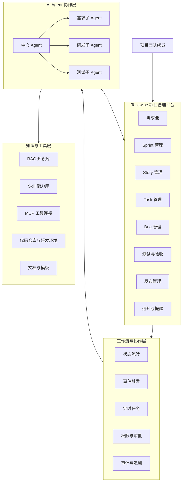
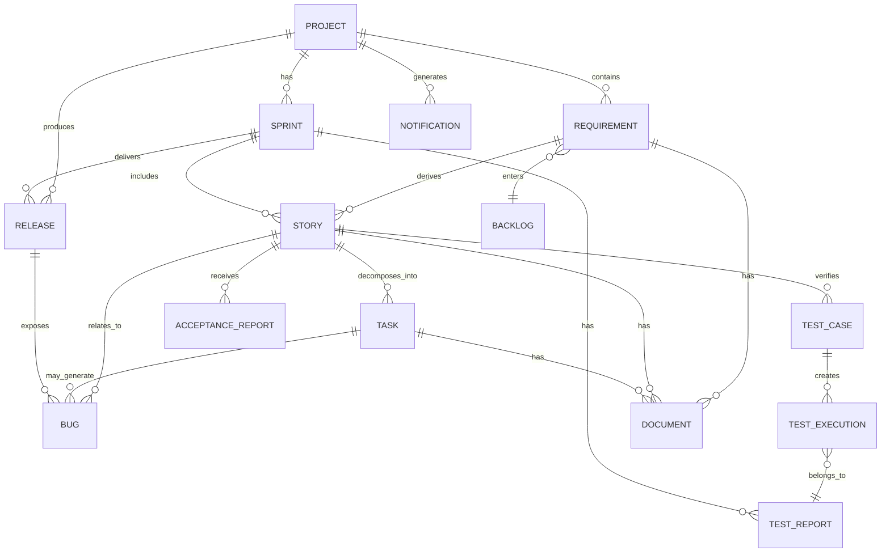

# Taskwise 项目简介

> 初稿

## 目录合理性评估

当前目录是合理的，能够覆盖 Taskwise 项目介绍中最重要的内容：为什么建设、服务谁、如何构成、管理什么数据，以及如何使用。

建议保留现有五个章节，并在章节内部补充以下内容：

- 在**项目背景**中说明现状问题、建设目标和产品定位；
- 在**适用人群**中区分直接使用者、协作参与者和管理者；
- 在**产品架构**中同时描述业务架构、工作流架构和 AI Agent 协作架构；
- 在**核心实体关系**中说明实体职责、生命周期和追溯关系；
- 在**最佳实践**中覆盖流程规范、角色协作、AI 使用、权限控制和数据治理。

后续如果进入产品设计或技术设计阶段，可以再单独增加以下文档：

- 产品范围与非目标；
- 详细业务流程与状态机；
- 权限模型；
- API 与 MCP 接口规范；
- AI Agent、Skill 和 RAG 知识库规范；
- 数据指标与运营报表设计。

---

## 1. 项目背景

### 1.1 研发项目管理现状

软件研发项目通常需要经历需求收集、需求分析、迭代规划、方案设计、开发、自测、测试、验收和发布等多个阶段。每个阶段由不同岗位负责，阶段之间存在大量的信息传递、文档编写、任务拆分、状态维护和结果确认工作。

当前工作流程主要依赖人工协作：

1. 需求发起人向产品经理反馈需求；
2. 产品经理完成初步调研和优先级评估，将需求维护至需求池；
3. 需求工程师从需求池选择需求，完成迭代规划、需求调研、分析、拆分和设计，并维护 Sprint 与 Story；
4. 需求工程师向产品经理及关键相关方确认需求范围和方案；
5. 需求工程师组织研发和测试团队进行迭代评审，并将 Story 拆分为研发 Task；
6. 研发工程师完成详细方案设计和编码，测试工程师完成测试用例设计与评审；
7. 研发、测试、需求和产品团队分别完成开发自测、SIT 测试、UAT 验收和生产发布。

在实际执行中，团队容易遇到以下问题：

- 需求信息分散在需求池、文档、会议记录、代码仓库和测试工具中；
- 需求、Story、Task、Bug、测试用例和发布结果之间缺少完整的关联关系；
- 需求分析、文档编写、任务拆分和测试用例编写存在较多重复劳动；
- 项目状态依赖人员主动维护，信息同步存在滞后；
- 关键风险、延期事项和范围变化不能及时触达相关人员；
- AI 生成的内容缺少项目上下文，难以直接融入现有研发流程。

### 1.2 建设目标

Taskwise 是一款专为软件开发团队设计的敏捷项目管理工具，目标是以项目管理为核心，将研发团队的工作对象、协作流程和 AI 能力统一起来。

Taskwise 重点解决以下问题：

- 以需求池、Sprint、Story、Task、Bug 和发布记录为核心，建立统一的研发工作台；
- 通过标准化的实体关系和状态流转，保证需求从提出到上线的全过程可追踪；
- 通过事件通知和定时提醒，降低团队的信息同步成本；
- 通过中心 Agent 协调需求、研发和测试等岗位子 Agent，辅助完成分析、设计、开发和测试工作；
- 通过 RAG、Skill 和 MCP 将项目知识、岗位规范和外部研发工具接入工作流；
- 保留人工确认、线下评审和审批机制，确保 AI 输出能够被审阅、修订和追责。

### 1.3 产品定位

Taskwise 的定位是：

> 面向软件开发团队的 AI 原生敏捷项目管理工具，通过中心 Agent 与岗位子 Agent 串联需求、研发、测试和交付流程，让团队专注协作、敏捷推进、持续交付。

Taskwise 不是单纯的任务看板，也不是完全自动化的无人研发系统。它以项目管理数据为基础，以工作流为骨架，以 AI 为协作能力，并通过人工确认保证关键决策和交付质量。

---

## 2. 适用人群

### 2.1 需求发起人

需求发起人可以提交业务需求、问题反馈或改进建议，并查看需求处理进度、当前状态和最终上线结果。

主要使用场景：

- 提交新需求；
- 补充需求背景、目标和期望结果；
- 查看需求是否进入需求池；
- 查看需求是否完成、取消或因重复提交而关闭；
- 接收需求上线通知。

### 2.2 产品经理

产品经理负责对需求进行初步调研、价值判断和优先级评估，并参与需求确认、UAT 验收和上线后的反馈闭环。

主要使用场景：

- 管理需求池；
- 评估需求优先级，标记紧急需求；
- 确认 Sprint 范围和 Story 方案；
- 参与 UAT 验收；
- 查看测试报告、验收报告和 Bug；
- 接收需求规划、关闭、测试完成和上线等通知。

### 2.3 需求工程师

需求工程师负责将原始需求转化为可评审、可开发和可验收的需求方案，是 Taskwise 中连接产品、研发和测试团队的关键角色。

主要使用场景：

- 分析需求边界、影响范围和依赖关系；
- 将需求规划到 Sprint；
- 维护 Story 和验收标准；
- 使用 AI 辅助生成原型和 PRD 初稿；
- 组织需求评审和迭代评审；
- 将通过评审的 Story 拆分为研发 Task；
- 跟踪测试、验收和上线状态。

### 2.4 研发工程师

研发工程师依据 Story、验收标准和详细设计说明书完成技术方案设计、编码、自测和缺陷修复。

主要使用场景：

- 接收和确认研发 Task；
- 查看 Story、关联文档、依赖关系和验收标准；
- 使用 AI 辅助生成详细设计说明书初稿；
- 使用 AI 辅助编码、自测和提交代码至 SIT 环境；
- 处理测试工程师、产品经理或 Agent 创建的 Bug；
- 查看 Sprint 变化和交付风险。

### 2.5 测试工程师

测试工程师负责测试用例设计、测试执行、Bug 提交和测试结论输出。

主要使用场景：

- 基于 Story 和验收标准生成测试用例初稿；
- 组织测试用例评审并维护最终版本；
- 在 SIT 环境执行测试并记录结果；
- 使用 AI 辅助提交 Bug 和生成测试报告；
- 测试通过后将 Story 标记为测试完成；
- 跟踪 Bug 修复和回归结果。

### 2.6 测试开发工程师

测试开发工程师当前作为相对独立的角色开展自动化测试，包括回归测试、接口测试、性能测试和功能测试。Taskwise 负责记录其测试结果、报告和 Bug 关联信息，暂不强制要求测试开发流程与岗位子 Agent 深度协同。

### 2.7 运维工程师

运维工程师根据发布通知执行生产环境构建和发布，并维护发布结果、发布时间和发布异常信息。

### 2.8 项目负责人和管理者

项目负责人或管理者通过项目总览、Sprint 看板、进度报表和风险信息了解项目执行情况。

主要使用场景：

- 查看项目整体进度；
- 识别延期、阻塞和范围变化；
- 了解团队工作负载和交付情况；
- 检查需求到发布的完整追溯链路；
- 评估 AI 对研发效率和交付质量的改善效果。

---

## 3. 产品架构

Taskwise 采用“项目管理平台 + 工作流引擎 + AI Agent 协作层”的产品架构。



### 3.1 项目管理平台层

项目管理平台是 Taskwise 的核心，负责保存项目研发过程中的结构化数据和协作记录。

主要模块包括：

- **需求池**：收集、评估、排序和关闭需求；
- **Sprint 管理**：维护迭代周期、迭代目标、范围和成员；
- **Story 管理**：描述用户价值、业务方案、验收标准和实现范围；
- **Task 管理**：承载研发、测试、设计等可执行工作；
- **Bug 管理**：记录缺陷现象、影响范围、复现步骤、修复结果和验证结果；
- **测试与验收**：管理测试用例、测试执行、测试报告和验收报告；
- **发布管理**：记录环境、版本、发布时间、发布结果和上线通知；
- **通知与提醒**：根据事件和时间规则向相关人员发送站内信。

### 3.2 工作流与协作层

工作流与协作层负责管理实体之间的状态变化、角色动作和团队通知。

#### 事件触发通知

当业务对象发生关键变化时，系统向相关角色发送通知，例如：

- 需求被标记为紧急时，通知需求工程师；
- 需求被规划至 Sprint 时，通知产品经理；
- Task 创建完成时，通知指定研发工程师；
- 代码提交至 SIT 后，通知指定测试工程师；
- Bug 创建后，通知研发工程师；
- Story 标记为测试完成后，通知需求工程师和产品经理；
- Sprint 范围变化时，通知需求工程师和研发工程师。

#### 定时提醒

系统按计划筛选需要关注的对象，并向相关人员发送提醒，例如：

- 长时间未更新的 Story；
- 临近预计完成时间的 Task；
- 临近预计完成时间的 Story；
- 临近结束时间的 Sprint。

#### 审计与追溯

系统应记录关键对象的创建人、更新时间、状态变化、操作人、审批结果和关联对象，确保每项需求都能追溯到对应的 Story、Task、代码、测试结果、Bug、验收结果和发布记录。

### 3.3 AI Agent 协作层

Taskwise 采用中心 Agent 与岗位子 Agent 的协作模式。

#### 中心 Agent

中心 Agent 是项目工作流的统一协调入口，主要负责：

- 理解项目、Sprint、Story 和 Task 的上下文；
- 识别当前工作阶段和下一步动作；
- 调度需求、研发和测试岗位子 Agent；
- 调用 RAG、Skill 和 MCP 能力；
- 将 AI 生成结果回写至 Taskwise；
- 触发通知、提醒或待确认事项；
- 检查关键环节是否满足进入下一阶段的条件。

中心 Agent 不应绕过权限、审批或人工确认直接完成高风险操作。涉及需求定稿、方案定稿、代码提交、状态关闭和生产发布的动作，应根据配置要求进入人工确认或审批流程。

#### 需求子 Agent

需求子 Agent 服务于产品经理和需求工程师，主要提供：

- 需求边界和影响范围梳理；
- 相关历史需求和项目知识检索；
- 方案分析与候选方案比较；
- HTML 原型生成与维护；
- PRD 初稿生成；
- Story 拆分和 Task 创建建议；
- 需求变更影响分析。

#### 研发子 Agent

研发子 Agent 服务于研发工程师，主要提供：

- 详细设计说明书初稿生成；
- 代码结构和实现方案建议；
- 基于项目规范的代码生成或修改；
- 自测用例和检查项生成；
- 代码变更说明生成；
- 代码提交至 SIT 前的检查；
- 测试 Bug 与代码变更的关联分析。

#### 测试子 Agent

测试子 Agent 服务于测试工程师，主要提供：

- 测试场景和测试用例初稿生成；
- 测试数据和边界条件建议；
- 测试结果分析；
- Bug 信息补全与重复缺陷识别；
- 测试报告生成；
- 根据测试结论建议更新 Story 状态。

### 3.4 知识与工具层

知识与工具层为 Agent 提供项目上下文、岗位规范和外部系统操作能力。

- **RAG 知识库**：保存历史需求、项目文档、技术规范、编码规范、测试规范和常见问题；
- **Skill 能力库**：封装 PRD 生成、原型生成、详细设计、测试用例生成和代码自测等可复用能力；
- **MCP 工具连接**：连接项目管理工具、代码仓库、CI/CD、测试平台、文档系统和通知系统；
- **模板中心**：提供 PRD、详细设计说明书、测试用例、测试报告和验收报告模板；
- **权限与凭证管理**：控制 Agent 可以读取和操作的数据范围，避免越权访问和越权执行。

---

## 4. 核心实体关系

### 4.1 实体总览

| 实体 | 主要职责 | 关键关系 |
| --- | --- | --- |
| 项目 Project | 组织团队、范围、成员和整体交付目标 | 包含多个 Sprint、需求和发布记录 |
| 需求 Requirement | 记录原始需求、背景、价值、来源和优先级 | 可进入需求池，可关联多个 Story |
| 需求池 Backlog | 管理待分析、待规划和待关闭的需求 | 包含多个 Requirement |
| Sprint | 定义一个迭代周期、目标和交付范围 | 包含多个 Story |
| Story | 描述可交付的业务需求、方案和验收标准 | 属于一个 Sprint，可拆分多个 Task |
| Task | 描述具体可执行工作 | 属于一个 Story，可由研发或测试人员负责 |
| Bug | 记录缺陷、影响、修复和验证信息 | 可关联 Story、Task、测试用例和版本 |
| 测试用例 Test Case | 描述验证需求的测试步骤和预期结果 | 关联 Story，可产生测试执行结果 |
| 测试报告 Test Report | 汇总一次测试活动的范围、结果和结论 | 关联 Sprint、Story 或版本 |
| 验收报告 Acceptance Report | 记录产品和需求侧的验收结果 | 关联 Story 或版本 |
| 发布 Release | 记录构建、部署、发布环境和上线结果 | 关联 Sprint、Story、代码版本和报告 |
| 文档 Document | 保存 PRD、原型、详细设计和会议结论 | 关联 Requirement、Story、Task 或 Release |
| 通知 Notification | 记录事件通知和定时提醒 | 关联业务实体和接收人 |

### 4.2 核心关系



### 4.3 实体说明

#### Project：项目

项目是 Taskwise 的顶层业务边界，用于隔离不同产品或研发项目的数据。

建议包含以下信息：

- 项目名称和项目编码；
- 项目目标和项目简介；
- 项目负责人；
- 产品、需求、研发、测试和运维成员；
- 代码仓库、测试环境和发布环境；
- 项目规范、模板和知识库；
- 项目状态和生命周期。

#### Requirement：需求

需求记录业务方或用户提出的原始诉求，是研发流程的起点。需求应保留原始描述，避免在分析过程中覆盖最初信息。

建议包含以下信息：

- 需求标题和详细描述；
- 需求来源和提出人；
- 业务背景、目标和预期价值；
- 优先级和紧急程度；
- 影响范围和关联系统；
- 当前状态和关闭原因；
- 关联 Story、文档和讨论记录。

#### Sprint：迭代

Sprint 是一个具有明确起止时间和交付目标的迭代周期。Sprint 范围应经过确认，范围变化需要保留变更记录并通知相关人员。

建议包含以下信息：

- Sprint 名称、目标和编号；
- 开始时间和结束时间；
- 负责人和参与成员；
- 计划范围和当前范围；
- 迭代状态；
- 进度、风险和范围变更记录。

#### Story：需求提单

Story 是经过需求分析和评审后形成的可交付业务需求。它应当让产品、需求、研发和测试人员对交付内容形成一致理解。

建议包含以下信息：

- 用户故事或业务目标；
- 背景和业务价值；
- 需求范围与非目标；
- 方案说明；
- 原型、PRD 和详细设计文档；
- 验收标准；
- 依赖、风险和影响范围；
- 负责人、参与人和预计完成时间；
- 关联 Task、Bug、测试用例、测试报告和验收报告。

#### Task：研发任务

Task 是从 Story 拆分出来的可执行工作单元，可以用于研发、测试、设计或其他项目工作。Task 应具有明确的负责人、完成条件和预计完成时间。

#### Bug：缺陷

Bug 用于记录测试、验收或 AI 分析发现的问题。Bug 应关联发现环境、复现步骤、实际结果、预期结果、严重程度和处理结论。

Bug 的关闭原因至少包括：

- 完成；
- 重复提交；
- 取消。

#### Test Case 与 Test Execution：测试用例与执行记录

测试用例描述验证目标、前置条件、操作步骤、预期结果和优先级。测试执行记录描述某个版本或环境中的实际执行结果，两者应分开保存，以便同一用例在不同版本中重复执行。

#### Release：发布

Release 记录从测试通过、UAT 验收、生产构建到发布完成的过程。发布记录应能够追溯到对应的 Sprint、Story、代码版本、测试报告、验收报告和发布结果。

### 4.4 推荐的追溯链路

Taskwise 应尽量保证以下链路完整：

```text
需求 Requirement
  -> Sprint
  -> Story
  -> Task
  -> 代码变更
  -> 测试用例 / 测试执行
  -> Bug
  -> 测试报告
  -> 验收报告
  -> Release
```

这条链路支持项目成员回答以下问题：

- 这个需求为什么要做？
- 需求最终拆成了哪些工作？
- 哪些代码变更实现了需求？
- 需求是否经过测试和验收？
- 当前是否存在未关闭的 Bug？
- 哪个版本已经上线？
- 需求变化是否影响了 Sprint 和其他任务？

---

## 5. 最佳实践

### 5.1 以 Story 作为跨角色协作中心

Story 应作为产品、需求、研发和测试团队之间的共同上下文，而不是只记录一个标题和几句话。

一个合格的 Story 至少应包含：

- 清晰的业务目标；
- 明确的范围和非目标；
- 可执行的方案说明；
- 可验证的验收标准；
- 关联原型、PRD 和设计文档；
- 已知依赖、风险和影响范围；
- 对应的 Task、测试用例和 Bug。

### 5.2 建立明确的准入和完成标准

建议为关键阶段定义 Definition of Ready 和 Definition of Done。

#### Story 进入开发前

- 需求目标和范围已经明确；
- 相关方已经完成需求确认；
- 验收标准已经明确；
- 研发和测试已经完成必要评审；
- 依赖关系和风险已经记录；
- 研发 Task 已经拆分并分配负责人。

#### Story 标记完成前

- 研发 Task 已完成；
- 代码已经完成自测并提交至指定环境；
- 测试用例已经执行；
- 阻塞性和高优先级 Bug 已处理；
- 测试报告结论为通过；
- 产品经理和需求工程师已经完成验收；
- 发布记录已经补充完整。

### 5.3 让 Sprint 范围保持稳定

Sprint 开始前应确认迭代目标、范围和成员。Sprint 开始后如果必须调整范围，应记录：

- 变更原因；
- 变更内容；
- 变更发起人；
- 受影响的 Story、Task 和人员；
- 对交付时间和质量的影响；
- 产品经理、需求工程师和研发工程师的确认结果。

范围变化应自动通知相关人员，避免团队继续按照过期计划工作。

### 5.4 AI 输出必须经过人工确认

Taskwise 中的 AI 输出应被视为初稿或建议，而不是最终事实。推荐采用以下流程：

```text
AI 生成
  -> 岗位人员审阅
  -> 补充和修改
  -> 提交评审
  -> 评审通过
  -> 写入正式版本
```

以下内容不建议由 Agent 直接完成最终提交：

- 需求定稿；
- 需求范围变更；
- 技术方案定稿；
- 测试用例定稿；
- 代码提交或合并；
- Bug 关闭；
- Story、Sprint 或 Release 的最终关闭；
- 生产环境发布。

### 5.5 优先使用项目上下文，而不是通用回答

Agent 生成内容时，应优先引用当前项目的结构化数据和受控知识库，包括：

- 当前 Project、Sprint 和 Story；
- 历史需求和已发布版本；
- 项目技术架构和编码规范；
- PRD、详细设计和测试规范模板；
- 当前代码仓库和分支信息；
- 已知 Bug 和历史解决方案。

RAG 检索结果应保留来源、版本和更新时间，避免 Agent 使用过期文档生成错误方案。

### 5.6 严格控制 Agent 的工具权限

不同岗位子 Agent 应拥有不同的数据读取和工具操作权限。

建议按以下原则配置：

- 需求子 Agent 可以创建或更新需求文档、原型和 Story 草稿；
- 研发子 Agent 可以读取已确认的 Story 和技术文档，并在人工确认后操作代码仓库；
- 测试子 Agent 可以生成测试用例、测试报告和 Bug 草稿；
- 生产发布相关操作必须经过明确授权和人工审批；
- Agent 的所有写入、状态变更和外部工具调用都应记录审计日志；
- MCP 工具应采用最小权限，避免使用共享的高权限凭证。

### 5.7 事件通知与定时提醒要避免信息噪音

通知应只发送给真正需要采取行动的人员，并明确说明：

- 发生了什么变化；
- 变化影响了什么对象；
- 收件人需要采取什么行动；
- 行动的截止时间；
- 相关对象的访问入口。

对于重复提醒，应支持合并、去重、静默和已读状态，避免团队因为过多通知而忽略真正重要的风险。

### 5.8 保持实体状态和文档状态一致

需求、Story、Task、测试用例、Bug 和 Release 的状态应由明确的业务动作驱动，不建议通过随意修改状态来表示进展。

例如：

- Story 不能因为研发 Task 完成就直接标记为已完成；
- 测试结论为通过后，才允许进入测试完成状态；
- Bug 关闭必须有修复说明和验证结果；
- UAT 验收通过后，才允许进入待发布状态；
- Release 完成后，才允许通知需求发起人已经上线。

### 5.9 用指标评估 AI 是否真正提升效率

Taskwise 可以持续记录以下指标：

- 需求从提出到进入 Sprint 的平均时间；
- Story 从创建到评审通过的平均时间；
- AI 初稿到人工定稿的修改比例；
- Task 拆分后的返工比例；
- 代码提交到测试完成的平均时间；
- 测试用例生成和维护耗时；
- Bug 重复提交率和平均修复时间；
- Sprint 按期完成率；
- 需求从提出到上线的交付周期；
- AI 生成内容被采纳、修改或拒绝的比例。

效率提升不能只看 AI 生成了多少内容，还应结合交付周期、返工率、缺陷率和团队实际使用情况综合判断。

### 5.10 从低风险、可验证的场景开始落地

推荐按以下顺序逐步引入 AI：

1. 需求摘要、影响范围分析和历史信息检索；
2. PRD、详细设计和测试用例初稿生成；
3. Story 到 Task 的拆分建议；
4. Bug 信息补全和测试报告生成；
5. 代码自测和提交前检查；
6. 经人工确认后的项目管理工具写入；
7. 在权限、审批和审计机制成熟后，再逐步扩大自动化范围。

---

## 6. 总结

Taskwise 以项目管理实体和研发工作流为基础，将需求、迭代、开发、测试、验收和发布统一到同一个协作上下文中。通过中心 Agent 协调岗位子 Agent，Taskwise 可以将 AI 能力嵌入软件研发团队的日常工作，而不是让 AI 成为独立于项目流程之外的聊天工具。

Taskwise 的核心价值可以概括为：

- **统一上下文**：让团队围绕同一套需求、任务、测试和发布信息协作；
- **串联工作流**：将跨岗位、跨阶段的研发工作连接起来；
- **减少重复劳动**：通过 Agent、RAG、Skill 和 MCP 辅助文档、任务、代码和测试工作；
- **保留人工决策**：AI 提效，人员确认，关键环节可审计；
- **促进敏捷交付**：减少信息等待和流程摩擦，让团队持续、专注地交付价值。
